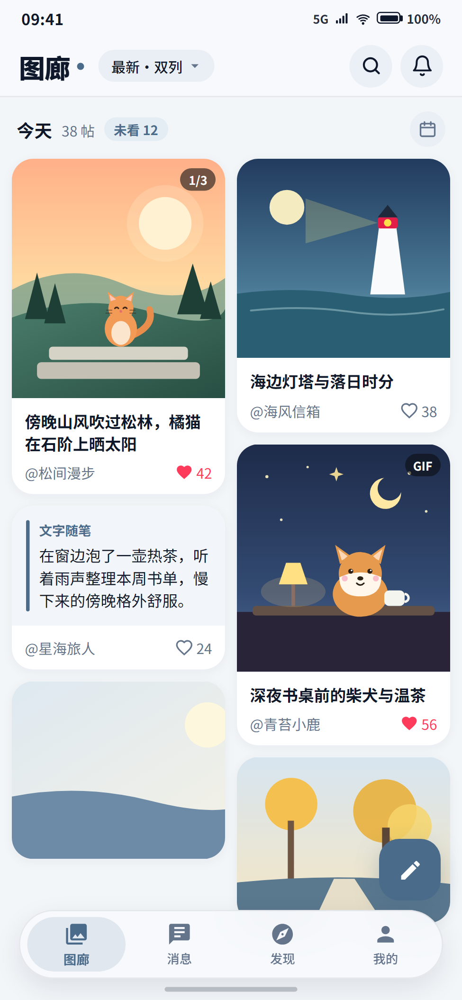
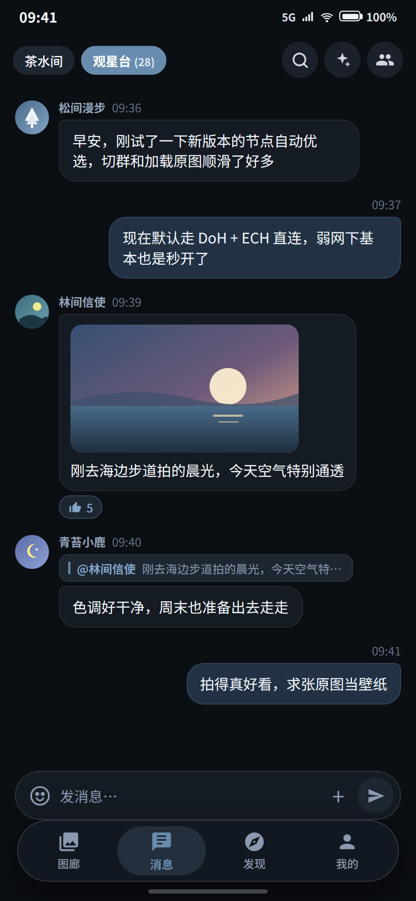
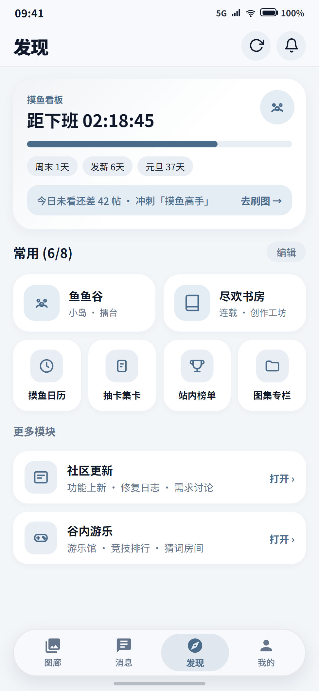
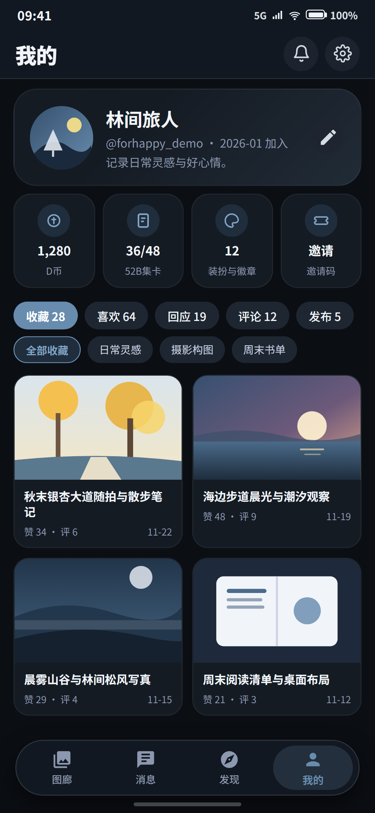

# 尽欢 (ForHappy)

第三方 **尽欢 (`52dmeme.com`)** 原生 Android 客户端，基于 Kotlin、Jetpack Compose 与 Rust 构建。

## 下载与安装

前往 **[GitHub Releases](https://github.com/DracaeneSunbringer/ForHappy/releases/latest)** 下载最新 `.apk` 安装包。

- **系统要求**：Android 8.0（API 26）及以上，支持 `arm64-v8a` 设备
- **应用内更新**：安装后可在「我的 → 版本与自动更新」中检查新版本并直接完成覆盖更新

## 界面预览

<table>
  <tr>
    <td align="center">
      <br />
      <sub>图廊浏览</sub>
    </td>
    <td align="center">
      <br />
      <sub>群聊与私信</sub>
    </td>
    <td align="center">
      <br />
      <sub>发现与百宝箱</sub>
    </td>
    <td align="center">
      <br />
      <sub>个人中心</sub>
    </td>
  </tr>
</table>

## 功能特性

- **图廊浏览**：支持单栏 / 双栏瀑布流切换，按最新、热门、最早、未读及标签筛选；支持高清原图双指缩放、GIF 与视频播放、帖子表情回应与短评互动，以及快捷发帖投稿。
- **群聊与私信**：支持多群聊频道与私信会话切换、社区表情包（Sticker）面板、引用回复、`+1` 复读、Boost 互动、消息搜索、未读进度同步与历史消息阅读位置保持。
- **鱼鱼谷与百宝箱**：提供鱼鱼谷岛屿状态面板与完整画布模式，支持猜词房间等社区互动玩法，并自动同步站点顶栏新增模块。
- **Rust 网络层 (`forhappy-net`)**：内置 DoH 域名解析、TLS 1.3 ECH（Encrypted ClientHello）、边缘节点并发测速优选与 HTTP/2 多路复用，支持在应用内查看连接诊断或配置自定义节点。
- **外观与隐私**：内置暖纸松绿（日间）、深松暗夜（夜间）及多种工作伪装主题，支持切换桌面启动图标、一键老板键与后台任务预览防截屏（`FLAG_SECURE`）。

## 目录结构

```text
.
├── app/                  # Android 客户端工程 (Kotlin + Jetpack Compose)
├── docs/
│   └── screenshots/      # 应用界面预览截图
└── rust/
    └── forhappy-net/     # 传输层动态库 (Rust + rustls + JNI)
```

## 从源码构建

### 环境要求

- JDK 17
- Android SDK（Platform 35）与 Android NDK（r27+）
- Rust 工具链（已安装 `aarch64-linux-android` 目标）与 [`cargo-ndk`](https://github.com/bbqsrc/cargo-ndk)

### 构建步骤

1. 编译 Rust JNI 动态库并输出至 `app/src/main/jniLibs`：

   ```bash
   rustup target add aarch64-linux-android
   cargo install cargo-ndk

   cargo ndk --manifest-path rust/forhappy-net/Cargo.toml -t arm64-v8a -P 26 -o app/src/main/jniLibs build --release
   ```

2. 使用 Gradle（或 Android Studio）构建客户端 APK：

   ```bash
   # 构建 Debug APK
   gradle assembleDebug

   # 构建 Release APK（可通过 KEYSTORE_FILE / KEYSTORE_PASSWORD / KEY_ALIAS / KEY_PASSWORD 指定签名证书）
   gradle assembleRelease
   ```

   编译产物位于 `app/build/outputs/apk/`。

## 说明

本项目为非官方第三方客户端，仅提供移动端浏览与交互界面，站点内容与账号服务均归原站点所有。
