# 01 · 顶层信息架构（IA）与全局导航

> 对应交接文档 **交付物 1**。所有决策以「Android 全面屏单手拇指操控」为第一性原理，并兼顾伪装态的结构同构（正常态 ↔ 飞书 IM 能一一映射，切换成本最低）。

---

## 1. 导航结构决策

### 1.1 备选方案对比

| 方案 | 结构 | 优点 | 缺点 | 评分 |
|---|---|---|---|---|
| **A（推荐）** | **4 Tab：图廊 / 消息 / 发现 / 我的** + 图廊 FAB 发帖 | 每个 Tab 都是高频独立心智；消息合一 = 飞书同构；FAB 只在需要的页面出现 | 发帖需先回到图廊（但系统分享、群聊转帖可绕过） | ★★★★★ |
| B | 4+1：图廊 / 消息 / ⊕发帖 / 发现 / 我的 | 发帖入口永远可见 | 中央凸起按钮占 1/5 底栏，日均点击极低；凸起在伪装切换时视觉跳变大 | ★★★☆☆ |
| C | 3 Tab：图廊 / 消息 / 我的，副玩法进「我的」 | 极简 | 鱼鱼谷/书房/摸鱼日历等日活入口被埋到第 2 层滚动里，「我的」又变成大杂烩（重蹈红线 4） | ★★★☆☆ |
| D | 5 Tab（现状）：图廊 / 群聊 / 固定模块 / 百宝箱 / 我的 | 无迁移成本 | 群聊私信割裂、「固定模块」与「百宝箱」语义重叠、单 Tab 宽度仅 78dp 标签被截断 | ★★☆☆☆ |

**结论：采用方案 A。** 方案 B 作为后续数据验证备选：若上线后发帖转化显著下降，可把 FAB 升级为底栏中央按钮，不影响其余 IA。

### 1.2 底栏定义

```
┌──────────────────────────────────────┐
│  🖼        💬 ⑫       🧭 •      👤 •  │  ← 64dp（含 16dp 手势条安全区以外）
│ 图廊       消息       发现      我的   │
└──────────────────────────────────────┘
```

| Tab | 内容 | 角标规则 | 再次点击当前 Tab | 长按 Tab |
|---|---|---|---|---|
| 图廊 | 图廊信息流（含标签/作者/图集等子流） | 无（新帖数不打扰；仅「新帖提醒」通知开启时显示小圆点） | 回到顶部；已在顶部则下拉刷新 | 打开「浏览设置」面板 |
| 消息 | 群聊 + 私信统一会话列表 | 未读总数（`99+`），`@我` 时数字变为强调色 | 跳到下一个有未读的会话 | 无 |
| 发现 | 摸鱼看板 + 副玩法宫格 + 动态模块 | 小圆点：鱼鱼谷可收获 / 站宠饱食过低 / 鞭打回复（各自可在设置里关闭） | 回到顶部 | 弹出「常用模块」快捷环（最多 4 个，直接进入） |
| 我的 | 个人枢纽 | 小圆点：有新版本 / 账号受限 / 新徽章 | 回到顶部 | 无 |

**底栏统一规则**
- 高度 56dp + 系统导航条 inset；图标 24dp，标签 11sp 固定显示（不做「仅选中显示标签」，减少误判）。
- 二级页面（帖子详情、群聊会话、设置等）**全部隐藏底栏**，把高度还给内容；返回即恢复。
- 图廊滚动时底栏 **不隐藏**（隐藏/显现的跳动会干扰停留 1s 已看计时与拇指肌肉记忆）；只有 FAB 随滚动隐藏/显现。

### 1.3 发帖入口（三路）

| 入口 | 位置 | 行为 |
|---|---|---|
| 图廊 FAB | 图廊右下，底栏上方 16dp，56dp 圆角方形 | 单击 → 发帖工作台（默认「图文」并直接拉起系统相册多选）；长按 → 小菜单 `图文 / 文字长帖 / 粘贴链接分享`；下滑隐藏、上滑或停止 600ms 后出现 |
| 系统分享 | 相册/其他 App →「分享到 尽欢」 | 弹出底部选择：`发到图廊` / `发到群聊…（选群）` / `发私信…` |
| 群聊转帖 | 群消息图片长按 → `转为图廊帖子` | 打开发帖工作台并预填图片与来源 |

### 1.4 顶栏统一规范（所有一级页）

- 高度 **48dp**（不含状态栏），**只有一行**；禁止出现 标题栏 + 搜索条 + 二级 Tab 三层叠放。
- 一级页顶栏右侧最多 **2 个图标**（如 `🔍` `🔔`）。
- 公告横条、网络异常提示这类临时信息 **挂在顶栏下方 32dp 单行**，可关闭，不常驻。
- 图廊、群聊会话中顶栏随向下滚动 **收起**（`enterAlwaysScroll`），向上滑立即回来。

---

## 2. 完整站点地图（Sitemap）

> 图例：`[N]` 原生 Compose；`[W]` 无壳 WebView 容器；`(S)` 底部面板 Bottom Sheet；`(D)` 对话框；`(F)` 全屏覆盖页。
> 已下线模块（`/puzzles` `/tools` `/farm` `/manor` `/huancai` `/music` `/nsfw`）**不出现在任何节点**。

```mermaid
flowchart TD
    ROOT["App 根"] --> WALL["图廊 Tab [N]"]
    ROOT --> MSG["消息 Tab [N]"]
    ROOT --> DISC["发现 Tab [N]"]
    ROOT --> ME["我的 Tab [N]"]
    ROOT --> GLOBAL["全局覆盖层"]

    WALL --> W1["信息流: 双列 / 单列 / 沉浸竖翻"]
    WALL --> W2["浏览设置面板 (S): 排序 未看 体裁 敏感四档 视图 按日 锚点"]
    WALL --> W3["搜索页 (F): 关键词 标签 作者 多选"]
    WALL --> W4["跳到哪天 日历 (S)"]
    WALL --> W5["子流: 标签流 / 作者流 / 图集索引 / 图集内流"]
    WALL --> W6["帖子详情 [N]"]
    WALL --> W7["发帖工作台 (F)"]
    W6 --> W61["沉浸看图舞台 (F): 轮播 长图 视频 GIF 实况"]
    W6 --> W62["一句话助推面板 (S)"]
    W6 --> W63["贴纸回应面板 (S)"]
    W6 --> W64["评论区 + 楼中楼"]
    W6 --> W65["解密挑战卡"]
    W6 --> W66["更多操作 (S): 收藏夹 转发到群 复制链接 保存 来源 编辑 NSFW 删除"]
    W7 --> W71["局部打码画板 (F)"]
    W7 --> W72["谜题编辑器 (S)"]

    MSG --> M1["会话列表: 全部 群聊 私信 @我 未读"]
    MSG --> M2["群聊会话 [N]"]
    MSG --> M3["私信会话 [N]"]
    MSG --> M4["新私信: 成员搜索 (F)"]
    MSG --> M5["可加入的群 / 申请进度"]
    M2 --> M21["猜词状态条 + 情报板"]
    M2 --> M22["猜词屋完整面板 (F): 本局 队列 历史 战绩"]
    M2 --> M23["发红包 (F) / 拆红包 (D) / 结果 (S)"]
    M2 --> M24["群信息页: 成员 审批 手气榜 红包归档 搜索 设置"]
    M2 --> M25["消息操作菜单 (S)"]
    M2 --> M26["历史搜索 (F)"]

    DISC --> D1["摸鱼看板卡 → 摸鱼日历页 [N]"]
    DISC --> D2["鱼鱼谷 [W] + 街机 史莱姆 打地鼠 裂隙 [W]"]
    DISC --> D3["站宠屋 / 擂台 [W]"]
    DISC --> D4["书房书架 / 阅读器 [W] + 原生协作条"]
    DISC --> D5["我的创作 [W]"]
    DISC --> D6["52B 抽卡 [W] / 图鉴 [N]"]
    DISC --> D7["鞭打路线图 [N]"]
    DISC --> D8["动态顶栏模块 [W]"]

    ME --> E1["资料头部 + 受限提示"]
    ME --> E2["资产行: D币钱包 52B集卡 装扮 邀请"]
    ME --> E3["我的内容 6 分类 + 收藏夹"]
    ME --> E4["设置中心 [N]"]
    E2 --> E21["钱包: 流水 财富榜 红包站密钥"]
    E2 --> E22["装扮工作室 (F): 4 处实时预览"]
    E4 --> E41["账号与安全 / 邀请码"]
    E4 --> E42["防窥与摸鱼"]
    E4 --> E43["浏览与内容"]
    E4 --> E44["群聊与私信"]
    E4 --> E45["通知偏好 16 项"]
    E4 --> E46["外观"]
    E4 --> E47["AI 小伙伴"]
    E4 --> E48["网络加速与内核诊断"]
    E4 --> E49["存储与缓存"]
    E4 --> E4A["关于与更新"]
    E4 --> E4B["管理后台 [W] 按权限"]

    GLOBAL --> G1["通知中心 (F)"]
    GLOBAL --> G2["公告详情 (S)"]
    GLOBAL --> G3["登录面板 (S)"]
    GLOBAL --> G4["伪装界面: 飞书 IM / LINUX DO"]
    GLOBAL --> G5["老板键: 飞书云文档 (F)"]
    GLOBAL --> G6["更新详情 (S)"]
```



### 2.1 层级深度约束

| 深度 | 定义 | 示例 |
|---|---|---|
| L0 | 4 个 Tab 根页 | 图廊流、会话列表 |
| L1 | 一跳可达的核心任务页 | 帖子详情、群聊会话、通知中心、设置首页 |
| L2 | 二级任务页 | 群信息页、钱包流水、设置子页 |
| L3 | 仅允许低频工程配置 | 网络内核日志、自定义优选 IP |

- **任何 P0 功能必须在 L1 以内完成主操作**（点赞、回应、一句话、评论、抢红包、猜词、发图）。
- 底部面板（Sheet）不计入深度，但面板内**禁止再嵌套面板**；需要更多空间时面板向上扩展为全屏，而不是叠第二层。

---

## 3. 全局界面层级（Z 轴）

```
Z5  老板键云文档（最高，盖住一切，包括 Dialog/Sheet/键盘——触发时先收起键盘、关闭所有浮层）
Z4  系统级对话框（拆红包、登录、确认删除）
Z3  底部面板 Sheet / 全屏覆盖页（通知中心、发帖、看图舞台）
Z2  Snackbar / 应用内横幅（更新提醒、网络异常、猜词结果提示）——位于底栏上方
Z1  顶栏 / 底栏 / FAB
Z0  内容
```

- 伪装界面不是 Z 层，而是**整棵 UI 树替换**（换主题 + 换导航壳 + 换组件皮肤），见 [03](03-privacy-state-machine.md)。
- Snackbar 在伪装态会自动换为目标 App 的 Toast 样式与措辞；在老板键态全部静默丢弃。

---

## 4. 账户状态与游客态

| 页面 | 游客 | 正式成员 | 受限（limits） |
|---|---|---|---|
| 图廊 / 详情 | 可浏览、看评论；点赞/回应/一句话/评论按钮可见，点击 → 登录面板 | 全功能 | 被限制的操作按钮置灰，点击弹出「限制类型 · 截止时间 · 原因」 |
| 消息 | 空态插画 + 「登录后加入群聊」按钮 | 全功能 | 禁言群：输入框替换为限制说明条 |
| 发现 | 可进书房阅读（书签存本地）；鱼鱼谷/站宠/抽卡点击 → 登录 | 全功能 | 同上 |
| 我的 | 头部替换为登录卡（4 种登录方式按钮），设置中心仍可进（主题、防窥、网络、更新） | 全功能 | 头部下方醒目限制条（警示色，可展开详情） |
| FAB | 隐藏 | 显示（TL 低于 `minPostTL` 时点击提示信任等级要求） | 被禁止发帖时隐藏 |

**登录面板 (S)**：`LINUX DO 登录`（主按钮）/ `Google` / `GitHub` / `邮箱验证码` / `账号密码`。OAuth 走无壳 WebView，完成后自动回到触发登录前的页面与操作（例如登录完自动执行刚才那一下点赞）。

---

## 5. 深链 / App Links 路由表

| 网站链接 | 客户端落点 | 返回栈 |
|---|---|---|
| `/` | 图廊 Tab | — |
| `/m/:id` | 帖子详情 | 图廊 → 详情 |
| `/t/:tag` | 图廊标签子流 | 图廊 → 标签流 |
| `/u/:author` | 图廊作者子流 | 图廊 → 作者流 |
| `/series`、`/s/:series` | 图集索引 / 图集内流 | 图廊 → 图集 |
| `/chat`、`/chat/:gid` | 消息 Tab / 群聊会话（带 `around` 时定位楼层） | 消息 → 会话 |
| `/dm`、`/dm/:uid` | 消息 Tab（私信筛选）/ 私信会话 | 消息 → 会话 |
| `/pets`、`/slime`、`/arcade/*` | 发现 → 对应 WebView | 发现 → 模块 |
| `/novels`、`/novels/studio` | 发现 → 书房 / 我的创作 | 发现 → 模块 |
| `/road` | 发现 → 鞭打 | 发现 → 鞭打 |
| `/me` | 我的 Tab | — |
| 已下线路由 | 按网站重定向结果落到图廊；**不做任何独立页** | — |

- 伪装态收到深链：在伪装壳内打开对应映射页（帖子 → 飞书 Thread / L 站楼层；群聊 → 飞书会话 / L 站聊天抽屉）；映射不到的（鱼鱼谷等）**静默忽略**，不弹任何提示。
- 老板键态收到深链：缓存到退出老板键后再处理。
