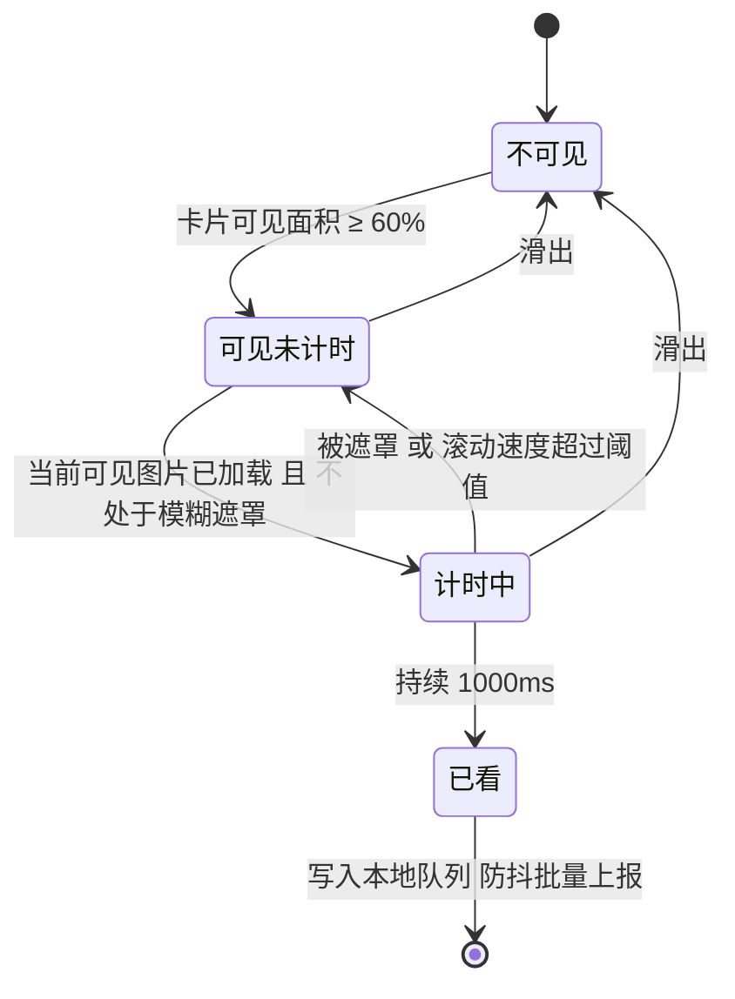
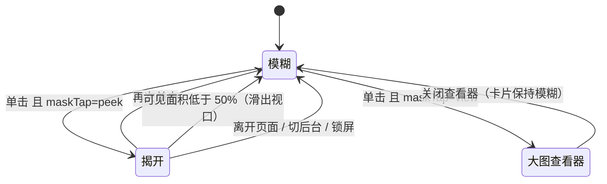

# 02a · 场景 A：图廊首页 & 筛选 / 搜索 / 按日空降

> 覆盖交接文档 1.2、1.3（卡片层展示）、红线 3、红线 5。

---

## 1. 首页布局（双列瀑布流 · 按日分组开启）

```
┌──────────────────────────────────────┐ ← 状态栏
│ 图廊  [最新·未看·双列 ▾]     🔍  🔔③ │ ← 顶栏 48dp（下滑收起）
├──────────────────────────────────────┤
│ 📣 新版鱼鱼谷节气活动上线…        ✕  │ ← 公告横条 32dp（仅有新公告时出现）
├──────────────────────────────────────┤
│ 今天 · 128 帖 · 未看 46        📅    │ ← 日期吸顶头 36dp（点按 = 跳到哪天）
├──────────────────┬───────────────────┤
│┌────────────────┐│┌─────────────────┐│
││                ││││                 ││
││    [ 图片 ]    ││││   [ 模糊图 ]    ││
││                ││││  ◌ 点按查看    ││
││         长图 ▤ ││││  敏感          ││
│└────────────────┘│└─────────────────┘│
│ 周一早上的我     │ 这谁顶得住        │ ← 标题 ≤2 行 14sp
│ 「善」×12 「神！」│ 🥲3  👍5           │ ← 一句话胶囊（≤2 个）/ 贴纸胶囊（≤3 个）
│ @阿鱼     ♡ 34   │ @小鹿     ♡ 8     │ ← 作者 + 赞（12sp 辅助色）
│┌────────────────┐│┌─────────────────┐│
││  ▶ 00:12  🔇   ││││ 📝 文字帖        ││
││   [ 视频 ]     ││││ 今天老板又说…   ││
│└────────────────┘│└─────────────────┘│
├──────────────────┴───────────────────┤
│ 昨天 · 211 帖 · 未看 0          📅    │
│               ...                ┌──┐│
│                                  │ ✚││ ← 发帖 FAB（下滑隐藏）
│                                  └──┘│
├──────────────────────────────────────┤
│  🖼图廊     💬消息⑫   🧭发现•   👤我的 │ ← 底栏
└──────────────────────────────────────┘
```

### 1.1 卡片信息规则（干净通透优先）

| 元素 | 规则 |
|---|---|
| 媒体 | 按原比例，瀑布流最高 `1.8 × 宽`，超出裁切并在右下角显示 `长图 ▤`；多图右上角 `1/4`；视频/GIF 右上角时长或 `GIF`；实况 `LIVE` |
| 标题 | 有则显示（≤2 行），文字帖显示正文前 4 行 |
| 一句话胶囊 | 最多 2 个最热的，`「善」×12`；点胶囊 = 跟投 +1（再点撤回），有触感反馈 |
| 贴纸胶囊 | 最多 3 个；点 = +1 / 取消；本人已投的胶囊用品牌色描边 |
| 作者/赞 | 一行；`♡` 点按即赞（卡片上就能赞，无需进详情） |
| **禁止** | 「已看/✓」角标、未看小红点、帖号、发布时间（按日分组已表达时间）、管理按钮 |

### 1.2 视图模式（浏览设置里切换）

| 模式 | 布局 | 适用 |
|---|---|---|
| 双列瀑布 | 默认，间距 8dp，卡片圆角 12dp | 快速扫图 |
| 单列大卡 | 全宽媒体，卡片下方完整展示一句话热评行 + 贴纸行 + 「评论 23」 | 认真看、互动 |
| **沉浸竖翻**（替代网页 `hz` 横向画廊） | 一帖一屏，上下翻页；右侧竖排 ♡ / 贴纸 / 一句 / 评论 / 分享 按钮（拇指区）；底部标题 + 胶囊 | 单手连刷 |

> 为什么不保留横向画廊：手机上横滑会与「多图轮播横滑」「系统左右边缘返回」三方冲突，竖翻在单手场景下更自然。

---

## 2. 浏览设置面板（替代网页多选筛选栏）

**入口**：顶栏摘要胶囊 `[最新·未看·双列 ▾]` 点按；或长按底栏「图廊」Tab。面板从底部升起，半屏高（可上拉全屏），所有控件位于拇指区。

```
┌──────────────────────────────────────┐
│               ───                    │ ← 拖拽把手
│ 浏览设置                    重置     │
│                                      │
│ 排序   (●最新) ( 热门 ) ( 最早 )      │
│ 只看未看                        [●━] │
│ 体裁   (●全部) (只看文字) (不看文字)  │
│                                      │
│ 敏感内容                             │
│ ( 隐藏 ) (●模糊) ( 显示 ) ( 仅看 )    │
│ 点模糊图时  (●原地揭开) ( 打开大图 )  │
│                                      │
│ 视图   [▦双列] [▭单列] [▯沉浸]       │
│ 按日分组                        [●━] │
│                                      │
│ 我的锚点                     管理 ›  │
│ ┌────────┐┌────────┐┌────────┐       │
│ │No.8812 ││No.8650 ││No.8011 │ ← 横滑 │
│ │11/16   ││11/14   ││11/02   │       │
│ └────────┘└────────┘└────────┘       │
│                                      │
│ 发图人 / 标签筛选      已选 2 项 ›    │ ← 进入搜索页的多选模式
│                                      │
│        [   应用（显示 46 帖）   ]     │ ← 实时计数，拇指区主按钮
└──────────────────────────────────────┘
```

- 修改即时预览计数，点「应用」才刷新信息流（避免边点边闪）。
- 摘要胶囊文案规则：`排序 · [未看] · [敏感档非默认时显示] · 视图`，最多 3 段，超出用 `+2`。
- 有作者/标签筛选时，顶栏标题区变为 `#打码 ✕` / `@阿鱼 ✕` 可一键清除的胶囊（替代「图廊」二字）。

---

## 3. 搜索页（全屏）

```
┌──────────────────────────────────────┐
│ ‹  [🔍 搜索帖子、标签、发图人      ] │
├──────────────────────────────────────┤
│ 最近搜索                    清空     │
│ (猫猫) (加班) (#打码)                 │
│                                      │
│ 热门标签                             │
│ (#梗图) (#职场) (#猫) (#长图) (#GIF)  │
│                                      │
│ ── 输入后 ──────────────────────────  │
│ [帖子] [标签] [发图人]   ← 结果分段   │
│ 标签/发图人分段支持多选 ☑，底部出现：  │
│        [ 用已选 3 项筛选图廊 ]        │
└──────────────────────────────────────┘
```

- 帖子结果复用图廊卡片（同一套视图模式与模糊规则）。
- 点卡片/详情页里的标签、作者直接进入 `/t/:tag`、`/u/:author` 子流（与图廊同壳，顶栏显示胶囊可清除）。
- 专题图集：搜索页「标签」分段顶部固定一行 `专题图集 ›` → 图集索引页（封面网格）→ 图集内流。

---

## 4. 按日分组与「跳到哪天」

```
点按日期吸顶头 📅
        ↓
┌──────────────────────────────────────┐
│ 跳到哪天                        ✕    │
│        ‹   2026 年 11 月   ›         │
│ 一  二  三  四  五  六  日           │
│                          1   2       │
│ 3   4   5   6   7   8   9            │
│ ·   ·   ·   ●   ·   ·   ·  ← 有未看帖的日期下方小点
│ ...                                  │
│ 16  17 [18]                          │
│                                      │
│ 选中：11月6日 · 184 帖 · 未看 12      │
│        [   跳到这一天   ]            │
└──────────────────────────────────────┘
```

- 日期吸顶头：`今天 / 昨天 / 11月16日 周日` + `N 帖 · 未看 M`（未看为 0 时只显示帖数）。
- 跳转后在该日首帖处定位，顶部出现 `↑ 回到今天` 小胶囊（3 秒后淡出为图标）。

---

## 5. 进度记忆与锚点

| 能力 | 交互 |
|---|---|
| 自动进度记忆 `wallPos` | 离开图廊 / 冷启动回来自动恢复到上次帖子，**无提示**；若恢复位置距顶部 > 50 帖，顶部出现 `↑ 最新` 小胶囊 |
| 插锚点 | 卡片长按 → 快捷菜单 `📌 插锚点`；已插锚点的帖子在卡片上**不显示标记**（保持干净），只在浏览设置的锚点栏出现 |
| 跳锚点 | 浏览设置面板「我的锚点」横滑卡片点击 → 关闭面板并定位 |
| 移除 | 锚点卡长按 → 移除；或「管理 ›」列表批量删除 |

### 5.1 卡片长按快捷菜单（单手高频互动的核心）

```
┌──────────────────────────────────────┐
│ ┌──────┐ 周一早上的我                 │
│ │ 缩略 │ @阿鱼 · No.8812              │
│ └──────┘                              │
│ 一句话  (善)(甚好)(666)(神！)(挂！) ✎  │ ← 点即发，✎ 自定义
│ 贴纸    😂 🥲 👍 🐟 [ld] [alu]   ＋    │
│ ─────────────────────────────────── │
│ ☆ 收藏到…        ↗ 转发到群聊        │
│ 📌 插锚点         🔗 复制链接         │
│ ⤓ 保存原图        ⋯ 更多             │
└──────────────────────────────────────┘
```

---

## 6. 停留 1s 自动标「已看」（静默状态机）



- **点开详情 = 立即已看**；模糊态卡片「原地揭开」后才开始计时。
- 快速甩动（列表滚动速度 > 1500dp/s）时暂停计时，避免一甩就标一大片。
- UI 上**零反馈**：无角标、无动画、无 Toast。唯一的可见结果是：开启「只看未看」时下次刷新不再出现；发现页摸鱼看板的「今日已看 N」数字变化。

---

## 7. 模糊图：「点按看清 ↔ 滑出自动复原」



| 状态 | 视觉 |
|---|---|
| 模糊 | 高斯模糊半径 32dp + 12% 暗化；中心 `◌ 点按查看`（13sp）；NSFW 帖左下 `敏感` 小标；**不显示任何标题外的细节** |
| 揭开 | 200ms 渐清；右上角 12dp 淡色 `◐` 提示「滑走会自动盖回」（仅前 3 次出现，之后不再提示） |
| 视频/GIF | 模糊态不自动播放、无声；揭开后按设置播放 |

- 「全图模糊 `blurAll`」开启时：所有媒体（含非敏感）都走此状态机；敏感档 `blur/only` 时仅敏感帖走此状态机。
- 揭开状态**只存在内存里**，任何页面切换都清空。
