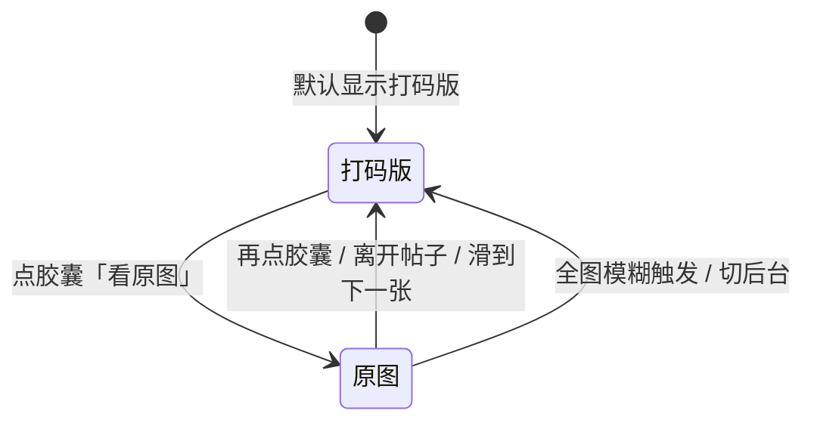

# 02b · 场景 B：沉浸看图舞台 & 帖子详情

> 覆盖交接文档 1.3（媒体形态、四层互动、帖子流转与管理）、红线 5。

---

## 1. 帖子详情页结构

从卡片点开，**共享元素过渡**（卡片图片放大到详情媒体区，280ms）。详情是 L1 全屏页，隐藏底栏。

```
┌──────────────────────────────────────┐
│ ‹                      No.8812   ⋯   │ ← 浮在媒体上的透明顶栏（滚动后变实底）
│┌────────────────────────────────────┐│
││                                    ││
││                                    ││
││          [ 媒体舞台区 ]            ││ ← 最高 70% 屏高，点按进入沉浸看图
││                                    ││
││ [打码版 ⇄ 原图]          ● ○ ○ ○   ││ ← 打码切换胶囊 / 轮播指示器
│└────────────────────────────────────┘│
│ 周一早上的我                          │ ← 标题 18sp
│ (阿鱼头像) 阿鱼 [摸鱼大师] · 2 小时前  │ ← 点作者 → /u/:author
│ #职场 #梗图 #打码                     │ ← 标签横滑（起点避让边缘）
│ 正文 Markdown……[spoiler 黑幕]……      │
├──────────────────────────────────────┤
│ 一句话 ·························· 全部 │ ← ② 第三层：一句话助推
│ (善 ×12)(神！×5)(太地狱了 ×3)(＋助推) │
│ 贴纸   😂 8  🥲 3  [ld:好] 2   ☺＋     │ ← 第二层：贴纸回应
├──────────────────────────────────────┤
│ 🔐 解密挑战 · 第 2 / 4 层         ▾  │ ← 内嵌解密（有才显示）
├──────────────────────────────────────┤
│ 评论 23              (最热) (最新)    │ ← 第四层：评论区
│ (头像) 小鹿 · 1 楼                    │
│ 这也太真实了 [pack:alu]               │
│   回复 · ♡ 3                          │
│   ┊ 阿鱼 回复 小鹿：哈哈哈            │ ← 楼中楼缩进 1 级，超过 2 条折叠
│   ┊ 展开 5 条回复 ▾                   │
│ (🤖头像) 欢欢 [AI] · 3 楼              │ ← AI 小伙伴专属标识
│ ...                                  │
├──────────────────────────────────────┤
│ [ 说点什么…        ] ♡34  ☺  「」  ⋯  │ ← 固定底部互动栏（拇指区）
└──────────────────────────────────────┘
```

### 1.1 「四层互动」严格分层

| 层 | 底部栏入口 | 详情内展示 | 交互 |
|---|---|---|---|
| ① 点赞 | `♡34` | 只在底部栏 | 单击切换；数字 = 站内赞 + L 站关联赞（长按数字弹出构成说明 `站内 21 · L 站 13`） |
| ② 贴纸回应 | `☺` | 「贴纸」行 | 底部栏 `☺` → 贴纸面板；点他人胶囊 +1 / 取消 |
| ③ 一句话助推 | `「」` | 「一句话」行（位于贴纸行上方，更醒目） | 底部栏 `「」` → 助推面板；点他人胶囊跟投 `×N`；**点数字**弹出参与人名单；自己的胶囊长按 → 撤回 |
| ④ 评论 | 输入框 `说点什么…` | 评论区 | 点输入框拉起键盘；支持 @、引用楼层、贴纸、配图 |

> 视觉区分：一句话胶囊用「书名号 + 浅品牌底色」，贴纸胶囊用「图标 + 数字 + 次表面底色」，评论是列表。三者永不混排。

### 1.2 一句话助推面板

```
┌──────────────────────────────────────┐
│ 一句话助推                    7 / 12 │ ← 显示单位计数（[pack:x] 算 1）
│ [ 太真实了[pack:alu]          ] 发送  │
│                                      │
│ 热梗  (善)(甚好)(欢欢)(妈妈)(666)     │
│       (太地狱了)(神！)(挂！)(我去~)    │
│       (大大大)(电！！)(不讲不讲)(魔了) │
│ 贴纸  [ld][alu][muscle] 😂 🥲 ...    │ ← 插入算 1 单位
└──────────────────────────────────────┘
```
- 点热梗 = **直接发送**（零确认，最快）；需要编辑时先点输入框再点热梗为「插入」。
- 超出 12 单位时计数变警示色，发送按钮置灰。

### 1.3 评论输入

- 键盘弹起时底部互动栏切换为评论编辑器：`[📷] [☺] [@]  输入框  [发送]`，详情列表 `imePadding`，被回复的评论自动滚到编辑器上方可见。
- 回复某楼：点该评论「回复」→ 编辑器上方出现引用条 `回复 小鹿：这也太真实了 ✕`。
- 帖子关闭 AI 评论时，AI 不会出现；用户可在评论中 `@欢欢` 与 AI 互动（AI 评论带 `AI` 标签与机器人头像角标）。
- 删除自己的评论：长按评论 → `复制 / 回复 / 删除`。

---

## 2. 媒体舞台区：各形态规则

| 形态 | 详情内 | 进入沉浸看图后 |
|---|---|---|
| 单图 | 等比适配宽度 | 双指缩放、双击放大/还原、下拉关闭 |
| 多图轮播 | 横滑翻页，底部圆点（>6 张显示 `3/12`） | 同上 + 横滑翻页；底部缩略图条可点跳转 |
| 九宫格 | 发帖者选择网格展示时：3 列网格 | 点哪张从哪张开始轮播 |
| 超长图 `长图` | 显示首屏 + 底部渐隐 + `展开长图 ▤` | **长图舞台**：全宽竖向滚动，右侧细进度条可拖动，双击放大局部 |
| GIF | 进入视口自动播放（非模糊态） | 同上 |
| 视频 | 封面 + `▶`，点按原地播放，默认静音，右下 `🔇/🔊` | 全屏播放：底部进度条可拖、倍速、静音切换；横屏视频自动建议旋转（不强制） |
| 实况 `LIVE` | 左上 `LIVE` 标；**长按播放**动态部分 | 同上 |
| 打码原图 | 左下胶囊 `打码版 ⇄ 原图`（仅发帖者保留原图时出现） | 同位置胶囊 |

### 2.1 沉浸看图舞台

```
┌──────────────────────────────────────┐
│ ✕                        3 / 4    ⤓  │ ← 单击图片切换显隐控件
│                                      │
│                                      │
│            [ 全屏图片 ]              │
│                                      │
│                                      │
│ [打码版 ⇄ 原图]                       │
│ ♡ 34    ☺    「」 12    💬 23         │ ← 底部互动条（与详情同源，不用退出就能赞/回应）
└──────────────────────────────────────┘
```
- **下滑关闭**（任意位置向下拖 > 120dp 或速度够快），背景随拖动渐透明；关闭时动画回到详情对应位置。
- 横滑翻页起点避让左右 24dp 系统返回热区（见 [04 手势规范](04-gestures.md)）。
- `⤓` 保存到系统相册（原图/GIF/视频原文件）；当前显示打码版时保存打码版。

### 2.2 打码版 / 原图切换


- 切到原图时胶囊变为警示描边 `原图 ⇄ 打码版`，提醒当前是未打码内容。
- 全图模糊开启时，必须先揭开模糊，才能切原图（两步，防误触社死）。

---

## 3. 内嵌多层解密挑战

展开态（点击卡片头 ▾）：

```
┌──────────────────────────────────────┐
│ 🔐 解密挑战             第 2 / 4 层 ▴ │
│ ●━━━━●━━━━○━━━━○                     │ ← 层级进度
│                                      │
│ [第 2 层线索图]（可点开看大图）        │
│ 问：图里第三个人手里拿的是什么？       │
│ 💡 提示（点按揭开）                   │
│ [ 输入谜底                 ] [解锁]   │
│                                      │
│ 通关奖励：🪙 50 D币                   │
└──────────────────────────────────────┘
```

| 状态 | 反馈 |
|---|---|
| 答错 | 输入框左右轻抖 + 触感「错误」振动；不清空输入 |
| 答对 | 进度点亮 + 下一层内容从下方展开（300ms）；键盘保持，焦点移到下一层输入框 |
| 全部通关 | 奖励卡：D 币 → `领取` 按钮（领取后金币飞向「我的」Tab 动效）；兑换码 → 文本 + `复制`；隐藏图文 → 原地展开 |
| 已通关回访 | 默认折叠为 `🔓 已通关 · 已领取 50 D币`，可展开回看各层 |

- 输入框获焦时：底部互动栏隐藏，键盘上方只保留解谜输入行，避免两个输入框同时存在。

---

## 4. 更多操作面板

```
┌──────────────────────────────────────┐
│ ☆ 收藏到…         ↗ 转发到群聊       │
│ 🔗 复制链接 No.8812  ⤓ 保存原图/视频  │
│ 🌐 查看来源           📌 插锚点       │
│ ─── 作者 / 管理员 ─────────────────  │
│ ✎ 编辑帖子          ⚠ 标记为敏感 [━●] │
│ 🗑 删除帖子（二次确认）               │
└──────────────────────────────────────┘
```

- **收藏到…**：多选收藏夹列表（勾选即生效）+ 顶部 `＋ 新建收藏夹`（行内输入，不再弹第二层）。
- **转发到群聊**：已加入群列表（按最近活跃排序，可搜索），可选附加一句话，发送后 Snackbar `已转发到「尽欢大群」· 去看看`。
- **编辑帖子**（作者/管理员）：复用发帖工作台（编辑模式）：删图、拖拽调序、增补新图、对已有图重新打码、改标题正文标签。
