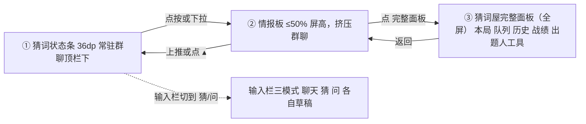

# 02c · 场景 C：消息 / 群聊 / 私信 / 欢欢猜词屋 / 全能红包

> 覆盖交接文档 1.5、1.6、1.7、红线 5、红线 6。本场景是移动端成败关键，篇幅最长。

---

## 1. 消息 Tab：统一会话列表

```
┌──────────────────────────────────────┐
│ 消息                      🔍  ✎  🔔③ │ ← ✎ = 新私信（成员搜索）
│ (全部) (群聊) (私信) (@我 2) (未读)   │ ← 筛选胶囊，横滑；选中态实底
├──────────────────────────────────────┤
│ 📌 (群头像) 尽欢大群        14:32  99+│
│    小鹿：[图片] 这个太好笑了     @我  │ ← @我 标签强调色
│ 📌 (群头像) 欢欢猜词屋群    14:30   3 │
│    🎯 第 12 局进行中 · 剩 03:21       │ ← 猜词进行中时摘要替换为状态
│ (头像) 阿鱼                 14:01   1 │
│    对方：周末岛上串门吗               │ ← 私信摘要：对方/我 前缀
│ (头像) 小鹿                 昨天      │
│    我：好的                           │
│ (群头像) 摄影小群            11/15    │
│ ...                                  │
│ ────────── 可加入的群 ──────────     │
│ (群头像) 内部审批群   [申请中·待审批] │
│ (群头像) 绘画交流     [申请加入]     │
└──────────────────────────────────────┘
```

- 置顶：默认群自动置顶，其余群/私信长按 → `置顶 / 标为已读 / 免打扰`。
- `@我` 筛选：列出所有含未读 @ 的会话，点进直接定位到 @ 那条（`around` 加载）。
- 搜索 `🔍`：同时搜会话名与成员；输入成员名可直接「发起私信」。
- 列表左右滑操作**不做**（避免与系统边缘返回冲突，统一用长按菜单）。

---

## 2. 群聊会话页

```
┌──────────────────────────────────────┐
│ ‹  尽欢大群 · 128 人在线      🔍  ⋯  │ ← 48dp；⋯ = 群信息页
├──────────────────────────────────────┤
│ 🎯 第12局 · 3字 · 剩03:21 · 线索2  ▾ │ ← 猜词状态条 36dp（仅有进行中/排队时出现）
├──────────────────────────────────────┤
│ ── 离开期间新增 37 条 · 跳到第一条 ── │ ← 回来时提示条（点按跳转，滑过即消失）
│                                      │
│ (头像) 小鹿 [猫猫教主] 127160楼 14:28 │
│        ┌──────────────────┐          │
│        │ 这图谁发的 No.8812│ ← 帖子预览卡
│        │ [缩略图] 周一早上 │          │
│        └──────────────────┘          │
│        这个太好笑了[pack:alu]         │ ← 同人连发合并头像昵称
│        😂 3  「笑死」×2               │ ← 贴纸/一句话助推回应
│                                      │
│        ┌─ 🧧 拼手气 D币红包 ──────┐  │
│        │  复读口令开  🔁           │  │ ← 红包气泡（门槛图标）
│        │  「周五了冲」             │  │
│        └───────────────────────────┘  │
│                         ┌──────────┐ │
│              127165楼 · │ +1 哈哈哈 │ │ ← 自己的消息（气泡皮肤）
│                         └──────────┘ │
│                              ┌──────┐│
│                              │↓ 12  ││ ← 回到最新浮标（不在底部时出现）
│                              └──────┘│
├──────────────────────────────────────┤
│ ┃ 回复 小鹿：这个太好笑了       ✕   │ ← 引用条（有引用时）
│ [聊天|猜|问] [ 发消息…      ] ☺  ⊕   │ ← 输入栏：有猜词局时出现模式切换
└──────────────────────────────────────┘
```

### 2.1 消息渲染规则

| 元素 | 规则 |
|---|---|
| 合并 | 同一人 3 分钟内连发只显示一次头像昵称 |
| 身份装扮 | 昵称渐变、称号、徽章（最多 2 枚）、专属气泡皮肤；受「洁癖开关」控制可关闭 |
| 楼层/时间 | `127165楼 · 14:28` 12sp 辅助色，默认只在每组首条显示；点消息可临时展开该条楼层时间 |
| 富文本 | `[pack:name]`、`:twemoji:`、代码块（横滑，起点避让边缘）、折叠详情、`[spoiler]` 点按揭开、`No.1234` 预览卡、`#标签`、`@成员` 高亮、外链（显示域名）、图片/GIF/视频网格（≤9）、**书房摘录卡**（纸色背景 + 书名章名，点按进书房对应位置） |
| 行内表情 | 行内表情高度 = 1.4em，基线对齐；加载中/失败显示同尺寸圆角占位块（不塌陷、不截字），失败可点重试 |
| 引用 | 消息内引用条点按 → 滚到原消息并 **闪光高亮 1.2s**；原消息编辑/撤回后，引用条实时更新为新内容 / `原消息已撤回` |
| 系统卡片 | 红包、头衔抽奖、猜词开局/结算、入群/退群、10 天未登录清理提醒（`chat_idle`） |

### 2.2 消息手势与操作菜单

| 手势 | 行为 |
|---|---|
| **左滑消息**（起点距右边缘 ≥ 32dp，水平位移 ≥ 56dp） | 引用回复：气泡跟手左移，越过阈值时触感 + 出现 `↩` 图标，松手即进入引用 |
| 长按消息 | 操作菜单（见下） |
| 点头像 | 成员资料卡（Sheet）：发私信 / @Ta / 查看发帖 |
| 长按头像 | 直接在输入框插入 `@昵称` |
| 双击 | **不定义**（避免与点按揭开 spoiler/图片冲突） |

```
长按消息 → 气泡上方浮出回应条 + 下方操作 Sheet
┌──────────────────────────────────────┐
│  😂  👍  🥲  🐟  [ld] [alu]   ＋      │ ← 一键贴纸回应
├──────────────────────────────────────┤
│ 「」一句话助推   ＋1 复读   ↩ 引用    │
│ ⧉ 复制          ⤓ 保存图片           │
│ 🖼 转为图廊帖子  ⓘ 助推记录           │ ← 转图廊仅含图片的消息显示
│ ✎ 编辑   ⟲ 撤回（仅自己的消息）       │
└──────────────────────────────────────┘
```

### 2.3 群信息页

- 头部：群头像、名称、公告、成员数。
- 列表：`成员`（搜索、管理员可移出）/ `入群审批 ③`（管理员）/ `红包手气榜` / `红包归档` / `猜词战绩榜` / `搜索聊天记录` / `新消息滚动策略` / `免打扰` / `退出群聊`。

### 2.4 历史搜索

- 顶栏 `🔍` → 全屏搜索：关键词输入 + `发言人` 筛选胶囊（成员多选）。
- 结果按时间倒序，命中词高亮；点结果 → 返回会话并 `around` 定位 + 闪光高亮 + 右下 `↓ 回到最新` 浮标。

---

## 3. 视口锚定工程要求（红线 6，研发验收清单）

| # | 场景 | 要求 | 实现约束 |
|---|---|---|---|
| 1 | 在底部时拉起键盘 | 消息列表随键盘同步上移，最新消息始终可见 | `reverseLayout` 列表 + `imePadding`；使用 `WindowInsetsAnimation` 逐帧同步，不得等键盘完全弹出再跳 |
| 2 | 正在看历史时拉起键盘 | 当前可见的第一条消息位置不变，不拽回底部 | 记录 `firstVisibleItem + offset`，inset 变化后恢复 |
| 3 | 上拉加载更早历史 | 当前阅读消息像素级不动 | 使用稳定 key（楼层号）；插入头部后用 key 恢复锚点；加载中顶部仅 24dp 小转圈 |
| 4 | 新消息到达 | 遵循「新消息滚动策略」设置（见下表） | — |
| 5 | 从通知/搜索/引用跳入 | `around` 加载目标前后各 30 条，目标居中 + 闪光；断层处显示 `加载更多 ▾` 分隔，向下滚自动补齐 | Room 分段缓存，段间衔接靠楼层号连续性判断 |
| 6 | 群聊 ↔ 猜词屋 | 各自保存滚动位置与草稿 | 见 §4 |
| 7 | 行内表情 | 固定占位尺寸，加载完成不改变行高 | 占位尺寸来自表情包元数据或默认 1.4em 方形 |

**新消息滚动策略**（群信息页 / 设置 › 群聊与私信）

| 选项 | 行为 |
|---|---|
| 仅在底部时跟随（默认） | 在底部 → 自动滚动；不在底部 → 浮标 `↓ N` 计数增加 |
| 总是滚到最新 | 任何新消息都滚到底（自己正在输入时也滚） |
| 不自动滚 | 只显示顶部/底部 `N 条新消息` 提示条 |

---

## 3.5 私信会话

与群聊复用同一套消息组件，差异：

- 顶栏：`‹ 对方昵称 [称号]  ⋯`（⋯ = 资料卡 / 搜索记录 / 免打扰）。
- 按 `UTC+8` 自然日插入日期分隔线 `—— 11月17日 周一 ——`。
- 输入栏 `⊕` 面板：`相册 / 拍摄 / 视频 / 文件`（无红包、无猜词）。
- 已读进度：自己最后一条消息下方小字 `已读`（对方读到时出现）。
- 引用、编辑、撤回同群聊；被引用的消息撤回时，引用处显示 `原消息已撤回`。
- 新私信：消息 Tab `✎` → 成员搜索页（全站搜索）→ 选人进入空会话。

---

## 4. 欢欢猜词屋：「群聊同屏」方案

### 4.1 方案选型

| 方案 | 描述 | 问题 | 结论 |
|---|---|---|---|
| 网页分屏照搬 | 上下分屏：上群聊下猜词 | 竖屏各剩 1/3 高，键盘一弹两边都看不见 | ✗ |
| 切页 Tab `聊天 | 猜词屋` | 群内顶部二级 Tab | 猜的时候看不到群里在聊什么；违反红线 5 多层标题 | ✗ |
| 底部 Sheet | 猜词屋作为可拖拽面板盖在群聊上 | 盖住最新消息，键盘与 Sheet 互相顶 | 次选 |
| **同屏（推荐）** | 群聊是主视口；顶部 **状态条** 可下拉为 **情报板**（挤压而非遮盖）；**输入栏三模式** 直接猜/问 | — | ✓ |

### 4.2 三个层级



### 4.3 状态条与情报板

```
群聊顶栏下（收起态）
┌──────────────────────────────────────┐
│ 🎯 第12局 · 3字 · 剩03:21 · 线索2  ▾ │ ← 倒计时 <30s 变警示色；我命中过时显示「最高 67%」
└──────────────────────────────────────┘

下拉展开（情报板，群聊消息区被压缩，最新消息仍贴底可见）
┌──────────────────────────────────────┐
│ 🎯 第12局 · 出题人 阿鱼 · 剩 03:21  ▴ │
│ 线索：① 是一种食物  ② 和夏天有关      │ ← 已公开线索，横滑
│ [高相关] [是 4] [否 7] [其他 3]       │ ← 情报 Tab
│ ┌──────────────────────────────────┐ │
│ │ 西瓜冰   ██████████  92%  小鹿   │ │ ← 高相关榜：命中字高亮
│ │ 冰西瓜   ████████    81%  我     │ │
│ │ 绿豆冰   █████       55%  阿鱼   │ │
│ └──────────────────────────────────┘ │
│ [💡要线索] [🗳 投票流局]  完整面板 ›  │
├──────────────────────────────────────┤
│ 群聊消息区（压缩后仍可滚动）           │
│ ...                                  │
├──────────────────────────────────────┤
│ [聊天|●猜|问] [ 猜一个答案…   ] 发送  │
└──────────────────────────────────────┘
```

| 情报 Tab | 内容 |
|---|---|
| 高相关 | 语义相关度 Top N，进度条 + 百分比 + 猜测人，命中字用强调色底 |
| 是 | 已确认「是」的问题列表（如「答案有三个字吗」） |
| 否 | 已确认「否」的问题列表 |
| 其他 | 「无法判断 / 不是问题」折叠清单 |

- 情报板高度可拖动（最小 160dp，最大 50% 屏高），记住上次高度。
- 键盘弹起时情报板**自动收缩为状态条**，键盘收起后恢复——保证打字时能看到最新消息与输入框。

### 4.4 输入栏三模式

```
[聊天|猜|问]  ← 仅当本群有进行中的猜词局时出现，否则输入栏回到普通形态
```

| 模式 | 占位文字 | 发送后 | 草稿 |
|---|---|---|---|
| 聊天 | `发消息…` | 普通群消息 | 独立保存 |
| 猜 | `猜一个答案…` | 提交猜测，结果（相关度 / 命中字）以「回执」形式贴在输入栏上方 2s，并写入情报板 | 独立保存 |
| 问 | `问一个是非题…（例：第一个字是水吗）` | 提交提问，判定结果（是/否/无法判断/不是问题）以回执显示并写入情报板 | 独立保存 |

- 模式切换 = 单击分段控件，或在输入框内**左右滑动 ≥ 48dp**（起点避让边缘）。三份草稿互不覆盖。
- `💡要线索` 按钮通过猜词专区接口 `POST /api/chat/messages/:mid/guess-room` 发送 `@欢欢 线索`（不往主群聊发普通消息）。
- **实时状态更新不打断打字**：猜中/开新局/截止时，状态条闪烁一次 + 轻触感；不弹窗、不抢焦点、不清空草稿。本局结束时若输入栏处于猜/问模式，自动切回聊天模式，但猜/问草稿保留到下一局。

### 4.5 猜词与主群聊消息边界（服务端隔离机制）

> 已对照网站 `guess-room.js` 源码核实：**猜答案（`!词`）、问是非（`?问题`）与 `@欢欢 线索` 均走猜词专区独立接口，不会广播进群聊主消息流。**

- 主群聊仅接收开局卡片以及猜中/流局/升级结算等系统通知卡片（如 `🎉 小鹿 猜中「西瓜冰」！ [打赏 D币]`）。
- 因此，群聊消息流**不存在**连续猜词文本刷屏问题，**无需**做连续猜词折叠摘要，也**无需**在群信息页或设置中增加「猜词消息呈现方式」冗余开关。

### 4.6 猜词屋完整面板（全屏）

```
┌──────────────────────────────────────┐
│ ‹  欢欢猜词屋 · 尽欢大群              │
│ [本局] [队列 3] [历史] [战绩榜]       │
├──────────────────────────────────────┤
│ 本局：倒计时 / 线索 / 情报四栏（全高）│
│ ── 出题人特权（仅出题人可见）──────── │
│ 🔒 答案密匣（长按 1s 查看）           │
│ [＋ 追加公开线索]   已用 2 / 60       │
├──────────────────────────────────────┤
│ 队列：等候中的局（娱乐局/D币悬赏/LDC） │
│      [＋ 发起一局]                    │
│      上一局结束 1 分钟内自动开下一局   │
│ 历史：轮次复盘（答案、猜中者、全部线索）│
│ 战绩榜：(今日|开站以来) × (猜中榜|胜率榜)│
└──────────────────────────────────────┘
```

- 发起一局（Sheet）：答案、初始线索、时长、类型（无奖娱乐 / D币悬赏 金额 / LDC 悬赏 金额）。
- 猜中者打赏：猜中系统卡片上 `打赏` → 金额快捷选项 `5 / 10 / 52 / 自定义`。
- 返回时回到群聊，**情报板展开状态、群聊滚动位置、三份草稿全部原样保留**。

---

## 5. 全能红包

### 5.1 发红包

入口：输入栏 `⊕` → 🧧 红包，全屏分步页。

```
┌──────────────────────────────────────┐
│ ✕  发红包                    步骤 1/3 │
├──────────────────────────────────────┤
│ 渠道   (●D币) (HB) (LDC Credit) (Fish)│
│ 类型   (●拼手气) (普通均分) (专属)    │
│        (定时开奖) (口令兑奖) (文本/CDK)│
│ 金额   [ 520      ] D币  余额 3,210   │
│ 个数   [ 10 ]                         │
│ ──────── 步骤 2：开包门槛 ────────── │
│ (●直接开) (复读口令) (解谜) (猜图)    │
│  └ 复读口令：[ 周五了冲          ]    │
│  └ 解谜：选择 6 种规则之一 →           │
│     双轨密码 / 回廊字阵 / 两步电台     │
│     倒放咒语 / 错位电波 / 弹幕拼字     │
│  └ 猜图：[选择站内图片] → 九宫格勾选清晰格 │
│ ──────── 步骤 3：封面与祝福 ──────── │
│ 封面 [默认][节日][自定义…]  祝福 [   ] │
│                                      │
│        [  塞进红包 520 D币  ]         │ ← 拇指区主按钮，二次确认金额
└──────────────────────────────────────┘
```

- 分步但**单页纵向滚动**（步骤是锚点，不是跳页），随时可回改；底部主按钮常驻。
- 「专属」类型出现成员选择器；「定时开奖」出现时间选择器。
- **两类外部/积分渠道区分处理（方案 3A）**：
  - **本站原生托管渠道**（D 币红包 `coin52`、站内解谜红包 `native`、本站原生 LDC 红包 `p.ldc`）：参数原生填写、原生拆包与领奖（`/redpack/open`、`/ldc/claim`）；仅原生 LDC 发包扣款步骤跳无壳加速 WebView（`credit.linux.do`）授权后回落原生结果页；
  - **第三方平台转发红包**（HB / Fish / 外部 Credit 分享链接 `p.external`）：不做油猴连接器脚本桥接；发包时选择渠道后直接引导打开内置加速 WebView 对应平台（HB / Credit / Fish）创建红包，完成后将分享链接/口令发回群聊。

**猜图门槛：九宫格选择器**

```
┌──────────────────────────────────────┐
│ 选择清晰格（建议 2–3 格）              │
│ ┌────┬────┬────┐                      │
│ │▒▒▒▒│ ✓  │▒▒▒▒│   ✓ = 保持清晰        │
│ ├────┼────┼────┤   ▒ = 端侧真马赛克     │
│ │▒▒▒▒│▒▒▒▒│ ✓  │                      │
│ ├────┼────┼────┤                      │
│ │▒▒▒▒│▒▒▒▒│▒▒▒▒│                      │
│ └────┴────┴────┘                      │
│ 答案（图梗名）[ 周一早上的我     ]     │
│ 预览即领包人看到的样子（不可逆合成）    │
└──────────────────────────────────────┘
```

### 5.2 拆红包（点红包气泡 → 居中对话框）

| 门槛 | 对话框内容 | 主操作 |
|---|---|---|
| 直接开 | 封面 + 发包人 + 祝福 | 大圆按钮 `開`（金币翻转动效 600ms） |
| 复读口令 | 显示口令「周五了冲」 | `一键复读并开`（自动向群发送口令消息并开包） |
| 解谜 | 对应规则的小游戏界面（字阵/电台/倒放…）+ 输入框 | `提交答案`，答错抖动可重试 |
| 猜图 | 马赛克线索图（可放大）+ 输入框 | `提交答案` |
| 定时开奖 | 倒计时 `14:59:32 开奖` + `参与` | 参与后按钮变为 `已参与 · 等待开奖`，开奖后通知 |
| 口令兑奖 / 文本 CDK | 兑奖输入框 / 奖品文本 | `兑换` / `复制` |
| 第三方转发红包（HB / Fish / 外部 `p.external`） | 平台标识 + 已知状态快照 + 剩余份数 + 活动口令（若有） | `一键复制口令` + 主按钮 `前往 HB / Fish 领取`（跳内置加速 WebView） |

### 5.3 拆包结果（Sheet）

```
┌──────────────────────────────────────┐
│          (发包人头像) 阿鱼的红包        │
│              🪙 52.00 D币              │ ← 抢到：数字滚动动效
│           手气最佳 👑（如是）           │
│ ─────── 领取明细 8/10 ────────────── │
│ 小鹿          88.88  👑               │
│ 我            52.00                   │
│ ...                                  │
│ [群手气榜 ›]          [红包归档 ›]    │
└──────────────────────────────────────┘
未抢到：🐱 空手小猫插画 +「手慢了，红包被抢光啦」
```

### 5.4 头衔抽奖

- 群内系统卡片：限定头衔预览（实际称号样式渲染）、报名人数、截止时间、`一键报名`；报名后变为 `已报名`；开奖结果以系统卡片 + 通知推送。
