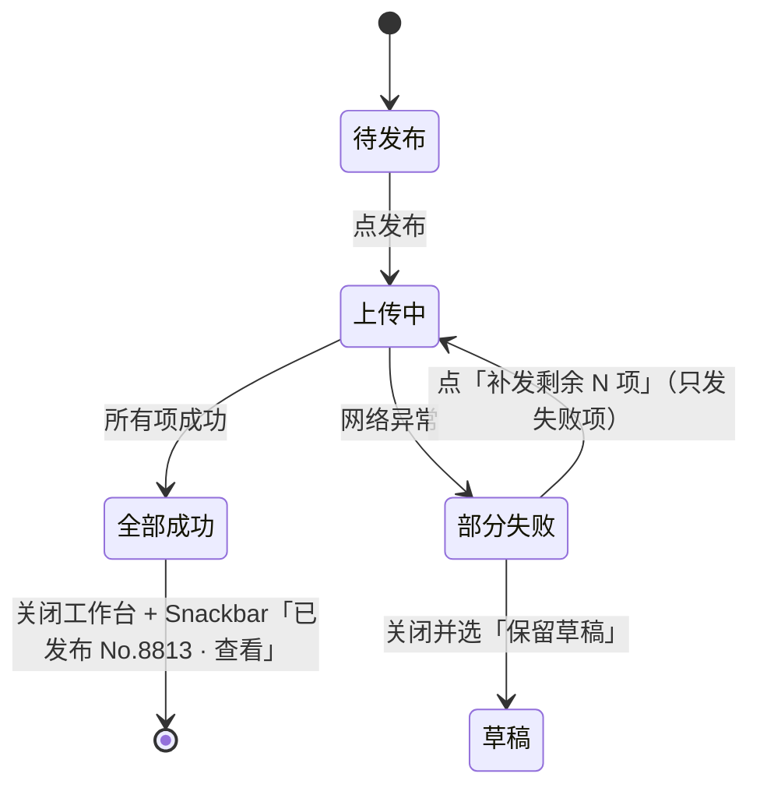

# 02d · 场景 D：移动端发帖工作台 & 局部打码画板

> 覆盖交接文档 1.4、2.1-4（系统分享接收、本地草稿）。

---

## 1. 发帖工作台（全屏覆盖页）

入口：图廊 FAB / 系统分享 / 群聊图片「转为图廊帖子」/ 详情「编辑帖子」（编辑模式）。

```
┌──────────────────────────────────────┐
│ ✕  发帖          (●图文)(文字)(链接)  │ ← 体裁分段
├──────────────────────────────────────┤
│ 📋 检测到剪贴板链接 bilibili.com/…    │ ← 剪贴板识别横条（仅检测到时，点按切到「链接」）
│    [生成分享帖]                   ✕  │
├──────────────────────────────────────┤
│ 发布方式 (●合并一帖) (每张单发) (自定义)│
│ ┌────┐┌────┐┌────┐┌────┐┌ ─ ─┐       │
│ │ 1  ││ 2  ││ 3  ││ ▶4 ││ ＋ │  ← 托盘横滑；长按拖拽排序
│ │🖌打码││    ││    ││0:12││    │       │
│ └────┘└────┘└────┘└────┘└ ─ ─┘       │
│  合 ▾  合 ▾  单 ▾  合 ▾   ← 仅「自定义」时显示每张的 合/单 开关
│ 共 4 项 · 18.2MB → 压缩后约 6.1MB     │
├──────────────────────────────────────┤
│ [ 标题（选填，80 字）           ]     │
│ [ 说点什么…（支持 Markdown）    ]     │
│                                      │
│ 标签  (#梗图)(#职场)(#猫) ＋自定义     │ ← 推荐标签点选 + 自定义
│       已选：#职场 ✕  #打码 ✕（自动）   │
│                                      │
│ ⚠ 敏感 / 慎点                   [━●] │
│ 🤖 关闭本帖 AI 小伙伴评论       [●━] │
│ 🔐 挂载解密谜题             未设置 ›  │
├──────────────────────────────────────┤
│ 草稿已自动保存          [  发布  ]    │ ← 底部固定发布按钮（拇指区）
└──────────────────────────────────────┘
```

### 1.1 托盘与发布策略

| 策略 | 结果 | 托盘视觉 |
|---|---|---|
| 合并一帖（默认） | 所有项作为一帖轮播 | 托盘项之间用细连接线串起 |
| 每张单发 | 每项一帖，共用标题/标签（标题可留空） | 托盘项间距加大，无连接线；发布按钮变 `发布 4 帖` |
| 自定义 | 每项下方 `合/单` 开关；所有「合」的项合并为一帖，每个「单」的项各一帖 | 发布按钮显示 `发布 2 帖`（实时计算） |

- 托盘项单击 → 小菜单：`打码 / 设为封面 / 替换 / 移除`；**长按拖拽**排序（拖动时其他项让位动画）。
- 文件规则：单文件 ≤ 20MB（超出项红框 + `超过 20MB` 不可发）；大图端侧自动压缩，显示压缩前后体积。
- `＋` 继续添加：系统照片选择器（多选）。

### 1.2 文字长帖 / 链接帖

- **文字**：托盘区隐藏，正文编辑器扩展；键盘上方 Markdown 快捷栏：`B  I  H  ❝  </>  ▸折叠  ▓spoiler  ☺贴纸  预览`。
- **链接**：粘贴/识别链接后生成预览卡（标题、封面、来源平台），可编辑标题与补充说明。

### 1.3 谜题编辑器（Sheet，可上拉全屏）

```
┌──────────────────────────────────────┐
│ 解密谜题                  ＋ 添加一层 │
│ 第 1 层  ▾                            │
│   线索图 [从托盘选/上传]              │
│   问题 [                    ]         │
│   提示 [                    ]（选填） │
│   答案 [                    ]         │
│ 第 2 层  ▸（折叠）                    │
│ 通关奖励 (●D币 [50]) (兑换码) (隐藏图文)│
│                         [ 完成 ]      │
└──────────────────────────────────────┘
```

### 1.4 批量发布与失败补发



托盘在上传中/部分失败时的项状态：

```
┌────┐┌────┐┌────┐┌────┐
│ ✓  ││ ✓  ││ ⚠  ││ ◔  │
│No.  ││No.  ││失败 ││62% │
│8813 ││8814 ││重试 ││    │
└────┘└────┘└────┘└────┘
        [ 补发剩余 2 项 ]
```

- 已成功项变为只读并标 `已发 No.x`，不会被重复发布。
- 关闭工作台时（有未发内容）：`保留草稿 / 丢弃 / 继续编辑`。草稿保留媒体与文案，下次点 FAB 时顶部提示 `有 1 份草稿 · 继续编辑`。

---

## 2. 局部打码画板（全屏，黑底）

```
┌──────────────────────────────────────┐
│ ✕   打码  1/4                  完成  │
├──────────────────────────────────────┤
│   ┌──────────────────────────────┐   │ ← 画布左右各留 24dp 黑边
│   │                              │   │   （绘制起点永不落在系统返回热区）
│   │   ▓▓▓▓▓       [ 图片 ]       │   │
│   │   ▓▓▓▓▓                      │   │
│   │            ┌ ─ ─ ─ ┐         │   │ ← 框选中的选区（可拖角调整）
│   │            │░░░░░░░│         │   │
│   │            └ ─ ─ ─ ┘         │   │
│   └──────────────────────────────┘   │
│                                      │
├──────────────────────────────────────┤
│ 工具   [▢ 框选]  [✎ 涂抹]   ↶  ↷     │
│ 笔触   (●马赛克) (模糊) (涂黑)        │
│ 粗细   ○━━━━━●━━━━━ ●                │ ← 仅涂抹工具显示
│ ☑ 同时保留原图（看帖人可切换查看原图）│
│   不勾选：仅上传打码后成品，原图不上传 │
└──────────────────────────────────────┘
```

### 2.1 画板手势

| 手势 | 行为 |
|---|---|
| 单指拖动 | 框选工具：画矩形选区（松手即应用当前笔触）；涂抹工具：沿轨迹涂抹 |
| 双指 | 缩放 + 平移画布（不绘制） |
| 双击 | 画布还原到适配屏幕 |
| 点已有选区 | 选中 → 可拖角调整 / 拖动移动 / 出现 `删除` 小气泡 |
| 系统返回 | 有未保存操作时确认 `放弃本张修改？` |

- 托盘多张时，顶栏 `1/4` 可点切换下一张，或在画板底部左右箭头切换（不使用横滑，避免与绘制冲突）。
- 「完成」：托盘对应项显示 `🖌打码` 标；帖子自动关联 `#打码` 标签（可手动移除）。
- 保留原图开关是**每张独立**的，默认继承上一张的选择。

### 2.2 系统分享接收

```
相册 → 分享 → 尽欢
┌──────────────────────────────────────┐
│ 分享 3 张图片到…                      │
│ [🖼 发到图廊]  → 打开发帖工作台，托盘预填 │
│ [💬 发到群聊…] → 选群 → 进入会话，图片预填在输入栏 │
│ [✉ 发私信…]   → 选人 → 同上           │
└──────────────────────────────────────┘
```
- 伪装态下接收分享：只提供「发到会话」（飞书风格选择器），不出现「图廊」字样。
