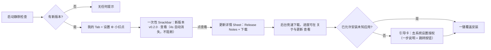

# 02e · 场景 E：「我的」枢纽 & 通知中心 & 设置中心

> 覆盖交接文档 1.1、1.12、1.13、2.1-1/2/3、红线 4。原则：**高频顺手、低频有序、零废卡堆砌**。

---

## 1. 「我的」Tab

```
┌──────────────────────────────────────┐
│ 我的                         🔔③  ⚙• │ ← ⚙ 小红点 = 有新版本
├──────────────────────────────────────┤
│ (头像)  阿鱼 [摸鱼大师]  🏅🏅🏅        │ ← 渐变昵称 + 称号 + 徽章展示柜前 3 格
│ 64dp    @ayu · 2025-03 加入            │
│         今天也要好好摸鱼（个签）    ✎  │
├──────────────────────────────────────┤
│ ⚠ 账号受限：禁言至 11/20 · 原因 ›     │ ← 仅受限时出现（警示色）
├──────────────────────────────────────┤
│ ┌────────┬────────┬────────┬───────┐ │
│ │ 🪙     │ 🃏     │ 🎨     │ 🎟    │ │ ← 资产行 4 格
│ │ 3,210  │ 42/120 │ 装扮   │ 邀请  │ │
│ │ D币    │ 52B集卡 │ 工作室 │ 码    │ │
│ └────────┴────────┴────────┴───────┘ │
├──────────────────────────────────────┤
│ [收藏] 喜欢  回应  评论  发布  最近看过 │ ← 6 分类 Tab，吸顶
│ (全部)(默认)(梗图库)(猫) ＋  ⇅  🔍     │ ← 收藏夹胶囊（仅收藏 Tab）+ 排序 + 搜索
├──────────────────────────────────────┤
│ ┌────┐┌────┐┌────┐                   │
│ │    ││    ││    │  ← 3 列方格缩略图   │
│ └────┘└────┘└────┘                   │
│ ...（无限下拉，复用图廊模糊规则）       │
├──────────────────────────────────────┤
│  🖼图廊     💬消息⑫   🧭发现•   👤我的 │
└──────────────────────────────────────┘
```

### 1.1 设计要点

- 头部 + 资产行合计 ≤ 260dp，首屏就能看到「我的内容」第一行，**「我的」页本身就是内容页**，不是设置列表。
- 顶栏 `🔔` 带红点数字 = 通知中心入口（与图廊/消息顶栏一致），不再在页内放通知预览卡。
- 头像点按 → 大图；`✎` → 资料编辑页（头像编辑器支持动图、昵称、个签）。
- **我的内容 6 分类**：`收藏 / 喜欢 / 回应 / 评论 / 发布 / 最近看过`；`⇅` 切换「新→旧 / 旧→新」，`🔍` 在当前分类内关键词检索。
  - 收藏：收藏夹胶囊横滑筛选；长按胶囊 → `重命名 / 删除`；`＋` 行内新建。
  - 回应、评论：列表形态（缩略图 + 我的回应/评论内容 + 时间），点按跳详情并定位到该评论。
  - 发布：方格；长按 → 编辑/删除。

### 1.2 D 币钱包（资产行 🪙 → L2 页）

```
┌──────────────────────────────────────┐
│ ‹  D币钱包                  财富榜 ›  │
│          🪙 3,210                     │
│   本月 +860 / −312                    │
│ (全部)(收入)(支出)(红包)(猜词)(抽卡)…  │ ← 流水类型筛选（30+ 类型归为 8 组）
│ 11/18 抽到红包 · 尽欢大群     +52     │
│ 11/18 52B 卡包                 −100   │
│ ...（分页）                           │
│ ─────────────────────────────────── │
│ 红包站密钥（需绑定 LINUX DO）       › │ ← 生成 / 查看(长按显示) / 复制 / 收回
└──────────────────────────────────────┘
```

### 1.3 52B 集卡（资产行 🃏）

- 原生图鉴页：收集进度 `42/120 · SSR 3/12`、按系列分组网格、未获得卡片剪影。
- 顶部 `抽卡 ›` → 抽卡动画（WebView 容器，见 [02f](02f-discover-and-webview.md)），抽完回到图鉴并高亮新卡。

### 1.4 装扮工作室（资产行 🎨，全屏）

```
┌──────────────────────────────────────┐
│ ✕  装扮工作室                  保存  │
│ ┌──────────────────────────────────┐ │
│ │ 实时预览（横滑切换 4 处）          │ │ ← 预览区固定在上半屏
│ │ [卡片] [群聊名牌] [聊天气泡] [回应框]│ │
│ │   (头像) 阿鱼 [摸鱼大师]           │ │
│ │   ┌────────────┐                  │ │
│ │   │ 今天也摸鱼 │ ← 当前气泡皮肤    │ │
│ │   └────────────┘                  │ │
│ └──────────────────────────────────┘ │
│ [称号] [昵称] [徽章柜] [气泡] [屏蔽]   │ ← 编辑分类 Tab
│ ─ 称号 ─                             │
│ (●自定义) (官方) (限定) (套装)         │
│ 文字 [摸鱼大师] 4/8                   │
│ 字体 ▾  形状 ▾  填充 (纯色)(渐变)(动效)│
│ 颜色 ● ● ● ● ＋                       │
└──────────────────────────────────────┘
```

| 分类 | 内容 |
|---|---|
| 称号 | 自定义（8 字内、字体、形状、填充纯色/渐变/动效、取色）或佩戴已获官方/限定（如 广结善缘）/抽奖套装等级/个人普通·SSR 套装 |
| 昵称 | 炫彩渐变预设 / 三色自定义渐变 |
| 徽章柜 | 徽章墙 + 资料卡 6 格展示柜拖拽排布 |
| 气泡 | 群聊气泡皮肤选择 |
| 屏蔽（洁癖开关） | 不看他人炫彩昵称 / 不看他人徽章 / 不看他人自定义样式 / 气泡显示开关 |

### 1.5 邀请码

- 生成 / 复制 / 撤销激活邀请码；邀请记录列表（状态、是否达标）；合格邀请奖励说明。

---

## 2. 通知中心（全屏覆盖页，从任意 `🔔` 进入）

```
┌──────────────────────────────────────┐
│ ‹  通知                全部已读   ⚙   │ ← ⚙ = 16 项提醒偏好
│ (全部)(@我 2)(评论)(回应)(喜欢)(群聊)  │
│ (新帖)(农场)(系统)          ☐ 只看未读 │ ← 9 分类横滑 + 未读筛选
├──────────────────────────────────────┤
│ 📣 公告：鱼鱼谷节气活动上线      ›   │ ← 未读公告置顶（点开完整富文本）
├──────────────────────────────────────┤
│ ● (头像) 小鹿 在群聊 @了你     14:28  │ ← ● 未读
│   尽欢大群：@阿鱼 快来看这个          │
│ ● (缩略) 阿鱼 等 12 人喜欢了你的帖子   │ ← 同帖同类聚合
│   周一早上的我                        │
│   (缩略) 小鹿 回复了你的评论   昨天   │
│ ⚙ 系统：新徽章「摸鱼高手」     昨天   │
│ ...                                  │
└──────────────────────────────────────┘
```

| 通知类型 | 点按路由 |
|---|---|
| 帖子互动（喜欢/回应/一句话/评论/回复/@） | `/m/:id` 详情，评论类定位到对应评论并闪光 |
| 群聊 @我 / 回复 / 红包结果 | 对应群聊 `around` 定位到消息 + 闪光 + `↓ 回到最新` |
| `join_req` | 群信息页 › 入群审批 |
| `chat_idle` | 对应群的重新申请加入页 |
| `release / skin_alert / pet_refund / ai_alert / badge` 等系统通知 | 完整详情对话框（富文本，支持复制、外链） |
| 农场 | 发现 › 鱼鱼谷（WebView），携带目标参数 |
| 新帖 | 帖子详情 |

- 点按即标已读；长按 → `标为已读/未读`。
- **提醒偏好**（`⚙`，同步 `PUT /api/notifs/prefs`）：16 个开关按 4 组排布——`互动`（喜欢、表情回应、一句回应、评论、回复评论、评论 @我、帖子里 @我）/ `群聊`（群聊 @我、群聊回复、红包开奖、入群申请·群管理）/ `内容`（新帖提醒、AI 评论与提及）/ `系统`（系统通知、农场攻防预警、新徽章）。

### 2.1 全站公告条

- 图廊顶栏下方 32dp 单行横条（跑马灯仅在文字超长时滚动一次后静止）；点按 → 公告详情 Sheet（富文本、复制、外链、`我知道了` 标已读收起）；`✕` 关闭即已读。
- 已读公告不再出现横条，可在通知中心「系统」分类回看。

---

## 3. 设置中心

```
┌──────────────────────────────────────┐
│ ‹  设置                               │
│ ── 常用 ───────────────────────────  │
│ 🛡 防窥与摸鱼            伪装:关 ›     │ ← 右侧显示当前关键状态
│ 🖼 浏览与内容            敏感:模糊 ›   │
│ 💬 群聊与私信                    ›     │
│ 🔔 通知偏好                      ›     │
│ 🌗 外观                  跟随系统 ›    │
│ ── 账号 ───────────────────────────  │
│ 👤 账号与安全                    ›     │
│ 🤖 AI 小伙伴                     ›     │
│ ── 应用 ───────────────────────────  │
│ 🌐 网络加速与诊断         正常 ›       │ ← 异常时显示「重连中」警示色
│ 💾 存储与缓存            312MB ›       │
│ ℹ 关于与更新        v0.1.5 · 有新版 •› │
│ ── 管理（按权限显示）──────────────  │
│ 🔧 管理后台                      ›     │
│                                      │
│          [ 退出登录 ]                 │
└──────────────────────────────────────┘
```

### 3.1 各子页内容

> 均为 L2 页；★ 标记为 L3 折叠项。

| 子页 | 内容 |
|---|---|
| **防窥与摸鱼** | 详见 [03 §6](03-privacy-state-machine.md#6-防窥与摸鱼设置页)：伪装皮肤、全图模糊、老板键、盲操触发器组合、回前台/锁屏策略、防截屏 `FLAG_SECURE`、桌面图标伪装 |
| **浏览与内容** | 敏感内容四档 `hide/blur/show/only`、模糊图点击行为 `peek/view`、默认视图模式、按日分组默认、视频自动播放（Wi-Fi/总是/从不）、默认静音 |
| **群聊与私信** | 新消息自动滚动策略、离开期间新消息提示条开关、聊天字号、发送键行为（回车发送/换行） |
| **通知偏好** | 16 项开关（同通知中心 ⚙） |
| **外观** | 浅色 / 深色 / 跟随系统；（可选）背景壁纸与暗角强度——移动端只保留「纯色 / 壁纸」二选一 + 一个强度滑块 |
| **账号与安全** | 登录方式绑定/解绑（LINUX DO / Google / GitHub / 邮箱）、修改密码、信任等级展示、邀请码入口、注销提示 |
| **AI 小伙伴** | 自有模型 API 配置（地址、Key 遮罩显示）、用途分配（评论互动 / 书房续写）、风格设定、自费说明 |
| **网络加速与诊断** | 见 §3.2 |
| **存储与缓存** | 图片缓存、表情包缓存、WebView 资源缓存、聊天记录缓存（各自大小 + 清理）、发帖草稿管理 |
| **关于与更新** | 见 §3.3 |
| **管理后台** | 按 `is_admin / owner / can_manage_ai` 显示：访问监控、随机图片设置与禁 tag、AI 全局接入、公告管理、成员权限与限制、管理员邀请码 → 无壳 WebView |

### 3.2 网络加速与诊断

```
┌──────────────────────────────────────┐
│ ‹  网络加速与诊断                     │
│ ┌──────────────────────────────────┐ │
│ │ ● 已连接 · 加速运行中              │ │ ← 状态卡（一眼看懂）
│ │ 节点 104.16.x.x · 86ms · ECH 已协商│ │
│ │              [ 重新优选节点 ]      │ │
│ └──────────────────────────────────┘ │
│ 启用 ECH                        [━●] │
│ IPv6 策略  (自动)(IPv4优先)(IPv6优先)(禁用)│
│ 自定义优选 IP                 3 个 ›  │ ★ 增删 + 单独启停
│ 引擎详情                          ›   │ ★ 端口、阶段、ECH 钥匙数、节点来源
│ 内核运行日志                      ›   │ ★ 最近日志，可复制/分享
└──────────────────────────────────────┘
```

**主界面网络状态呈现规则**

| 内核状态 | 正常态主界面 | 伪装态 | 老板键 |
|---|---|---|---|
| 健康 | **无任何提示** | 无 | 无 |
| 启动中 / 重连中（> 3s） | 顶栏下 32dp 温和提示条 `网络连接中…`（辅助色，无技术字样），点按 → 诊断页 | 目标 App 原生风格提示：飞书 `网络连接不可用，请检查网络设置` / Discourse 顶部 `正在重新连接…` | 无 |
| 失败 | 提示条 `网络连接失败 · 点按查看`（警示色） | 同上 | 无 |

### 3.3 关于与更新

```
┌──────────────────────────────────────┐
│ ‹  关于与更新                         │
│ 尽欢 v0.1.5                           │
│ ┌──────────────────────────────────┐ │
│ │ 新版本 v0.2.0 · 15.8MB             │ │
│ │ 更新说明（折叠 3 行 · 展开）        │ │
│ │ [ 下载并安装 ]                     │ │
│ │ ━━━━━━━━━━━━░░░░ 68% · 1.2MB/s    │ │ ← 下载中：进度、速度、当前镜像
│ └──────────────────────────────────┘ │
│ 启动时自动检查更新              [━●] │
│ 下载加速                          ›   │ ★ 自定义 GitHub 加速前缀、镜像池同步时间
│ 开源许可 / GitHub Release         ›   │
└──────────────────────────────────────┘
```

**更新提醒流程**



- 伪装态 / 老板键态：**不出现任何更新提示**（小红点、Snackbar 全部抑制），回到正常态后再显示。
- 同一版本的 Snackbar 只出现一次；之后只保留小红点。
