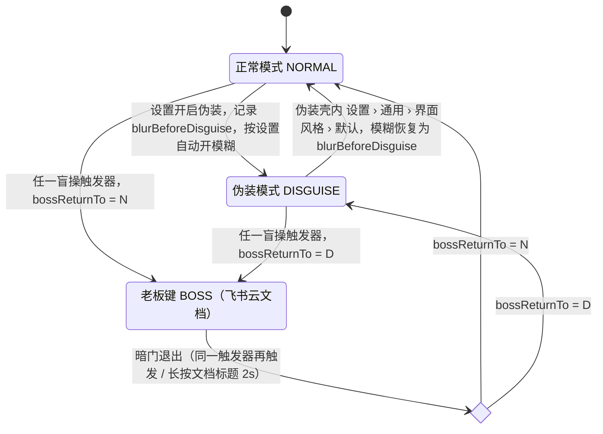
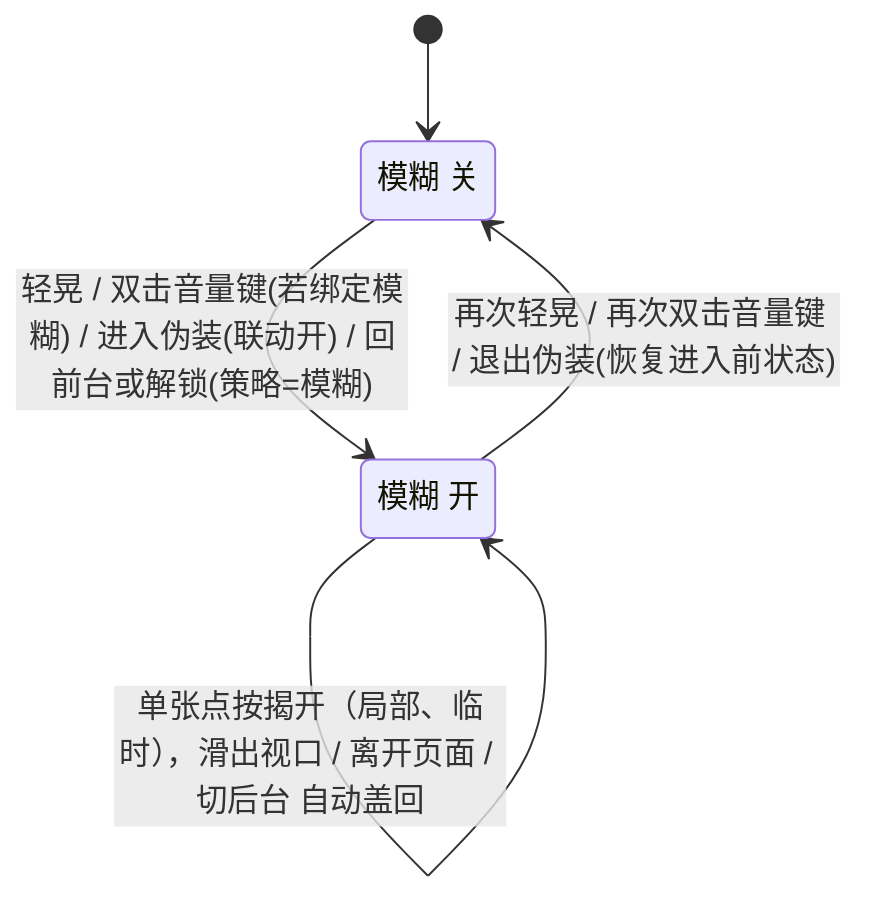

# 03 · 三层防窥全链路状态机与零死角伪装方案

> 对应交接文档 **交付物 3**，落实 **红线 1、红线 2**，并覆盖 1.14、2.1-1（伪装下禁露网络技术字样）、2.1-3（图标别名、`FLAG_SECURE`、盲操触发器）。

---

## 1. 三层分工（一张表说清楚，严禁叠床架屋）

| 层 | 风险场景 | 用户还要不要继续用 | 形态 | 触发方式 |
|---|---|---|---|---|
| ① 界面伪装（飞书 IM / LINUX DO） | 路人余光扫视 | **要**，照常看图、回应、水群 | 整棵 UI 树换皮（导航、组件、配色、措辞全部替换） | 设置开关（低频、主动） |
| ② 全图模糊 | 突然滑出社死图 | 要，点哪张看哪张 | 媒体遮罩层，滑出自动复原 | 盲操（轻晃 / 音量键）+ 自动（进伪装、回前台） |
| ③ 老板键（飞书云文档） | 有人走到身边盯屏 / 扣放桌面 | **不要**，只求 1 秒死守 | 全屏静态文档，盖住一切 | 盲操（连滑返回 / 音量键 / 扣放 / 回前台） |

**零废柴按钮原则（红线 2）**：正常界面、伪装界面的一级视觉区**不存在**任何老板键或糊图按钮。所有触发器只在「设置 › 防窥与摸鱼」里勾选。

---

## 2. 状态模型

主状态（互斥）× 正交状态（独立叠加）：

| 维度 | 取值 |
|---|---|
| **主状态** | `NORMAL` 正常 / `DISGUISE(feishu \| linuxdo)` 伪装 / `BOSS` 老板键 |
| 正交：全图模糊 | `on / off` |
| 正交：防截屏 `FLAG_SECURE` | `on / off` |
| 正交：桌面图标别名 | `尽欢 / 飞书文档 / 协作文档`（持久设置，与主状态无关） |
| 记忆 | `bossReturnTo`（进入老板键前的主状态）、`blurBeforeDisguise`（进入伪装前的模糊状态） |

### 2.1 主状态机



- **进入老板键的瞬间（0 动画、≤ 1 帧）**：收起软键盘 → 关闭所有 Dialog/Sheet/菜单 → 暂停并静音所有音视频与 WebView 音频 → 渲染云文档。顺序保证不会出现「文档盖上了但键盘还在」。
- 退出老板键：恢复到 `bossReturnTo` 的**原页面、原滚动位置、原草稿**（老板键只是覆盖层，不销毁下层状态）。
- 老板键期间**冷启动**（被系统杀掉后重开）：直接恢复为老板键（持久化 `isBoss`），防止「重开 App 露馅」。

### 2.2 全图模糊（正交）



- 模糊开关**切换时有极短触感（10ms）**作为盲操确认，无 Toast、无图标闪现。
- 揭开状态只在内存，任何页面切换、切后台都清空（规则详见 [02a §7](02a-scenario-wall.md#7-模糊图点按看清--滑出自动复原)）。

---

## 3. 盲操触发器矩阵

### 3.1 触发器 → 可绑定动作

| 触发器 | 判定 | 可绑定 | 默认 | 生效范围 | 冲突消解 |
|---|---|---|---|---|---|
| **连滑两次系统返回** | 450ms 内两次返回，且当前为**根页面**、无 Dialog/Sheet/键盘/菜单 | 老板键 | 开 | 正常 / 伪装 | 非根页面时第一次返回正常执行返回；有浮层时返回先关浮层，不计数 |
| **双击音量上键** | 350–420ms 内两次按下 | 老板键 / 全图模糊 / 无 | 老板键 | 正常 / 伪装 / 老板键（退出） | 首次按下**正常透传给系统调音量**（不延迟拦截，保证日常单按/长按调音量零粘滞）；窗口内检测到第二次按下时消费事件并触发动作；视频全屏播放时同样生效 |
| **双击音量下键** | 350–420ms 内两次按下 | 老板键 / 全图模糊 / 无 | 全图模糊 | 同上 | 同上；与音量上互不冲突，两键不可绑定同一动作由设置页校验 |
| **屏幕朝下扣放** | 先检测到正面朝上，后 `z < -8` 且 `|x|,|y| < 4` 持续 300ms | 老板键 | 关 | 正常 / 伪装 | 翻回正面**不会**自动退出老板键（安全优先） |
| **轻晃手机** | 650ms 内两次加速度峰值 > 16.8，冷却 1.2s | 全图模糊开关 | 关 | 正常 / 伪装 | 鱼鱼谷等 WebView 游戏内自动停用（防误触）；步行/车载颠簸由峰值阈值 + 冷却过滤 |
| **切后台 / 锁屏后回来** | `onStop` → `onStart` | 不处理 / 全图模糊 / 老板键 | 全图模糊 | 正常 / 伪装 | 由系统分享、相册选图、OAuth 登录等**应用自己发起**的跳转回来不触发 |

- 传感器监听**仅在相关开关开启时注册**，关闭即注销（省电，与现有 `DeviceStealthSensorObserver` 一致）。
- 所有触发都提供**可关闭的 10ms 确认触感**。

### 3.2 老板键退出暗门

| 暗门 | 说明 | 默认 |
|---|---|---|
| 同一触发器再触发一次 | 例如双击音量上进入 → 再双击音量上退出；连滑两次返回进入 → 再连滑两次返回退出 | 开 |
| 长按文档标题 2 秒 | 无任何按压反馈（不出现水波纹），2s 到达时 10ms 触感后退出 | 开 |
| 在协作者头像组上连点 5 次 | 备用暗门，可选 | 关 |

- 老板键页面上**单次系统返回 = 无动作**（被吞掉；若目录抽屉打开则先关目录），绝不会意外退出到桌面或露出尽欢。
- **页面上不存在任何退出/恢复/返回尽欢的文字、按钮、浮标。**

### 3.3 触发器生效前提

- 只在 App 处于前台时生效（Android 不允许后台拦截音量键，也不应在后台读传感器）。
- 系统权限：传感器、音量键拦截均无需额外权限；不使用无障碍服务（避免权限敏感与上架风险）。（注：暂不做 Android Quick Settings 系统下拉快捷磁贴，避免借手机或下拉通知栏时的误触与好奇露馅风险。）

---

## 4. 各状态下的全局联动规则

| 项 | 正常 | 伪装 | 老板键 |
|---|---|---|---|
| UI 壳 | 尽欢 4 Tab | 飞书 IM（消息/通讯录/我的）或 LINUX DO 长帖 | 飞书云文档 |
| 全图模糊 | 用户开关 | 进入时按设置自动开启；退出恢复进入前状态 | 文档无图片，状态冻结保持；退出后若设置「退出老板键后保持模糊」（默认开）则强制开 |
| `FLAG_SECURE` | 跟随设置 | 跟随设置（建议开） | **跟随设置全程保持（绝不临时解除）**：避免切后台 `onStop` 系统截屏竞态抓到未遮挡画面，并防止国产 ROM 动态摘挂 Window Flag 引发黑屏闪烁 |
| 音视频 | 正常 | 默认静音自动播放关闭 | 立即暂停 + 静音 |
| 应用内音效 / 振动 | 正常 | 关闭娱乐音效；消息提示音不响 | 全部静默（触发确认触感除外） |
| Snackbar / 横幅 | 尽欢样式 | 换为目标 App Toast 样式与措辞 | 全部丢弃 |
| 网络异常提示 | 温和提示条（无技术字样） | 目标 App 原生断网提示 | 无 |
| ECH / Edge IP / ms 等字样 | 仅出现在设置诊断页 | **任何位置不出现**（诊断页不可达） | 不出现 |
| 更新提醒 | 小红点 + 一次性 Snackbar | 抑制 | 抑制 |
| 品牌元素（松绿、站徽、图廊、鱼鱼谷、发现、摸鱼收益） | 显示 | **全部移除** | 无 |
| P2 WebView 模块 | 可达 | 不可达（入口不存在，深链静默忽略） | 不可达 |
| 深链 | 正常路由 | 映射到伪装壳内对应页；映射不到静默忽略 | 缓存至退出后处理 |
| 系统通知栏（如有本地通知） | 尽欢样式 | 标题统一为图标别名名称 +「你有一条新消息」，不含内容 | 不发出 |
| 多任务卡片标题 | 跟随图标别名 | 跟随图标别名 | 跟随图标别名 |

---

## 5. 伪装界面方案

### 5.1 飞书 IM：消息主列表

```
┌──────────────────────────────────────┐
│ (我)  消息                    🔍  ⊕  │ ← 左上头像=我的；⊕=发起单聊/搜索会话（发帖直接走工作群底部输入栏）
│ [全部] 未读  单聊  群组  @我          │ ← 飞书式文字 Tab（下划线选中）
├──────────────────────────────────────┤
│ ┌──┐ 产品设计评审群            14:32 │
│ │产│ 张伟：[图片]                  ⑫ │ ← 每日图廊工作群（12 个按日轮换）
│ └──┘                                 │
│ ┌──┐ 研发中心-全员群            14:30 │
│ │研│ 李娜：@我 这个方案再看下      ❾ │ ← 真实群聊（别名映射）
│ └──┘                                 │
│ ┌──┐ 王芳                      14:01 │
│ │王│ 周末那个需求方便对一下吗       ① │ ← 真实私信
│ └──┘                                 │
│ ┌──┐ Q4 运营推进群              昨天 │
│ │Q4│ 刘洋：[图片]                     │
│ └──┘                                 │
│ ┌──┐ 交付保障专项群            11/16 │
│ ...                                  │
├──────────────────────────────────────┤
│   💬 消息      👥 通讯录      👤 我的  │ ← 3 Tab，全部是真功能
└──────────────────────────────────────┘
```

| 元素 | 规则 |
|---|---|
| 头像 | 群：圆角方块 + 2 字简称 + 飞书色板随机底色；人：圆形 + 姓氏 |
| 时间 | `HH:mm` / `昨天` / `MM/dd`，与飞书一致 |
| 未读 | 红色胶囊数字；免打扰群为灰点 |
| 底栏 | `消息`（会话列表）/ `通讯录`（真实成员列表与搜索，点人 = 发私信）/ `我的`（伪装设置入口）。**无假「云文档」Tab** |
| 禁止 | 尽欢松绿、站徽、图廊/发现字样、表情包大图摘要（摘要统一为 `[图片]` `[表情]` `[视频]`） |

### 5.2 飞书 IM：工作群内浏览与直接发言发帖（每日图廊群）

```
┌──────────────────────────────────────┐
│ ‹  产品设计评审群 (42)          👥 ⋯ │
├──────────────────────────────────────┤
│ ┌──┐ 张伟  14:28                      │
│ │张│ 周一的进度截图同步一下            │ ← 帖子标题 → 消息正文
│ └──┘ ┌────────────────┐              │
│      │                │              │
│      │  [ 图片预览 ]   │ ← 飞书图片消息：8dp 圆角、最大宽 68%、全图模糊默认开
│      │                │              │
│      └────────────────┘              │
│      👍 12  😂 3  ✅ 2                 │ ← 赞→👍；贴纸→飞书表情回复
│      💬 5 条回复 ›                     │ ← 一句话+评论 → 回复串入口
│                                      │
│ ┌──┐ 李娜  14:26                      │
│ │李│ ┌──────┬──────┬──────┐           │ ← 多图：飞书图片网格
│ └──┘ │ img  │ img  │ +2   │           │
│      └──────┴──────┴──────┘           │
│ ┌──┐ 刘洋  14:20                      │
│ │刘│ ┌─ 📄 文本消息 ────────────────┐ │ ← 文字帖：飞书富文本卡片
│ └──┘ │ 关于周会纪要的补充：…         │ │
│      └──────────────────────────────┘ │
├──────────────────────────────────────┤
│ ┃ 回复 张伟：周一的进度截图…      ✕   │ ← 挂上引用 = 给张伟那帖发评论；不挂引用 = 发新帖
│ [ 发送到 产品设计评审群…  ] ☺  🖼  ⊕ │ ← 标准飞书输入栏：直接选图/输字发帖或评论
└──────────────────────────────────────┘
```

| 尽欢概念 | 飞书映射与「群内原生操作闭环」 |
|---|---|
| 一天的图廊帖子 | 当日轮换的 12 个工作群之一（按帖子 ID 稳定分配；群名池 + 日期种子） |
| 发帖人 | 40 位中文真名同事（按作者 ID 稳定映射，同一作者当天始终同一人名） |
| 帖子标题 / 正文 | 消息文字；无标题时用工作化占位短句池（「同步一下」「见图」「截图供参考」） |
| **发帖（图文 / 纯文字）** | **直接利用工作群底部标准输入栏**：点 `🖼` 选单图/多图（弹出飞书风格待发图片预览条，点缩略图可进飞书皮肤打码画板或切「合并一帖 / 逐张单发 / 内容需确认」），配文字点发送 = 发布为图廊新帖并追加至工作群流尾（若在 `#标签` 话题工作群内发送自动带上该标签）；未挂引用时直接发送纯文本 = 发布纯文字帖 |
| **评论** | **左滑工作群内某条消息或长按选「回复」挂上引用条**，在底部输入栏发送 = 直接给该帖发评论（发送后自动清除引用）；或点 `💬 N 条回复 ›` 进回复串（Thread）看全部评论与楼中楼并继续发言 |
| 点赞 | 长按消息浮层点 `👍` 表情，或直接点消息下方 `👍 12` 胶囊（数字 = 赞数） |
| 贴纸回应 | 飞书表情回复胶囊（社区自制包映射为最接近的飞书默认表情；不显示动漫贴纸原图）；长按消息点反应条或胶囊 `+1` |
| 一句话助推 | 底部输入栏 / 话题页 `☺` 面板顶部的飞书「快捷表态短语」胶囊（挂引用发或话题页点选即发 ≤12 单位助推），以及话题页顶部的短回复胶囊区 |
| 筛选（排序/未看/敏感档） | 群设置页 `⋯` › `消息筛选`（伪装措辞：「只看未读消息」「按时间排序」「敏感内容过滤」） |
| 停留 1s 已看 | 照常静默运行 |
| 长按消息 | 飞书式浮层菜单：`👍 😂 ✅` 表情回应一排 + `回复（评论此帖）/ 打开话题 / 转发 / 收藏 / 复制链接 / 保存图片` |

**回复串（Thread）= 帖子详情**

```
┌──────────────────────────────────────┐
│ ‹  话题                               │
│ ┌──┐ 张伟  14:28                      │
│ │张│ 周一的进度截图同步一下            │
│ └──┘ [图片]（点按 → 飞书式图片查看器） │
│      👍 12  😂 3  ＋                   │
│ ── 5 条回复 ────────────────────────  │
│ ┌──┐ 赵敏：善                    14:29│ ← 一句话助推（短回复，带 ×12 跟投小标）
│ ┌──┐ 孙浩：这个方案可以，周三前定稿 14:31│ ← 评论（楼中楼 → 飞书「回复 @某人」）
│ ...                                  │
├──────────────────────────────────────┤
│ [ 回复话题…                ] ☺  ⊕    │ ← 输入即评论；☺ 面板顶部一排「快捷短语」=一句话预设
└──────────────────────────────────────┘
```

### 5.3 真实群聊私信与每日工作群的融合规则

- **一张列表混排**：真实群聊、真实私信、每日图廊工作群按最后活动时间统一排序；筛选 Tab `群组` 同时包含真实群与工作群，`单聊` = 真实私信。
- **真实群聊**：群名按本地别名表映射（如 `尽欢大群 → 研发中心-全员群`），用户可在 `群设置 › 修改群名备注` 改；输入框照常可用，所有消息能力保留（引用、贴纸、一句话、红包、猜词）。
- **真实成员**：昵称原样显示会露馅时，可开启「成员显示为同事姓名」（按用户 ID 稳定映射到姓名池）；头像统一为姓氏字头像。
- **红包**：伪装为飞书「红包」消息（飞书真实存在），拆包对话框换飞书红包样式；外部渠道名称隐藏，仅显示「红包」。
- **猜词屋**：状态条伪装为飞书「群待办」条 `📋 待办：第 12 项讨论中 · 剩 03:21`；情报板伪装为「投票/表格」卡片样式；输入栏模式切换文案改为 `消息 / 提交 / 提问`。
- **帖子预览卡 No.xxx**：伪装为飞书「消息链接」卡片。

### 5.4 LINUX DO 论坛长帖

```
┌──────────────────────────────────────┐
│ ≡  LINUX DO                 🔍  💬 (我)│ ← 💬 = 聊天抽屉；(我) = 用户菜单
├──────────────────────────────────────┤
│ 【持续更新】每天摸鱼时收集的图，欢迎佬 │
│ 友补充                                │
│ ■ 搞七捻三   #资源分享 #持续更新        │ ← 分类色块 + 标签
├──────────────────────────────────────┤
│ (A) ayu_dev          #12      3 小时  │ ← 字母头像 + 用户名 + 楼层 + 相对时间
│ 周一早上的我                           │
│ ┌──────────────────────────────────┐ │
│ │        [ 图片（灯箱缩略） ]        │ │ ← Discourse lightbox 样式，模糊默认开
│ └──────────────────────────────────┘ │
│ 「善」×12 「神！」×5                    │ ← 一句话 → 帖子下方短回复胶囊（boosts 风格）
│ 😂 3  👍 5          ♡ 34   🔗  ↩ 回复 │ ← 反应 / 赞 / 链接 / 回复
│ ▸ 5 条回复                            │ ← 评论区 → 展开回复
├──────────────────────────────────────┤
│ (X) xiaolu           #13      3 小时  │
│ ...                                  │
│                          ┌─────────┐ │
│                          │ 12 / 480│ │ ← 右下楼层进度胶囊：点按展开时间线
│                          └─────────┘ │
└──────────────────────────────────────┘
```

- **时间线跳转**：点 `12 / 480` → 右侧展开竖向时间线（顶部「原始帖子」、底部「最新」，可拖动滑块到指定楼层，显示日期）。时间线占右侧 64dp，从屏幕右缘向内 24dp 开始，避开边缘返回热区。
- **一帖一楼**：每条图廊帖子 = 一楼；用户名用作者真实用户名或映射名（设置项）。
- **回复** = 评论编辑器（Discourse 底部升起的编辑器样式，含工具栏 `B I 🔗 “ </> ☺ 📷`）；快捷短语（一句话预设）在 ☺ 面板顶部。
- **筛选** = 左上 `≡` 菜单中的「帖子设置」：`仅显示未读楼层`、`排序`、`敏感内容`。
- 长按楼层图片 → Discourse 式操作：`下载 / 复制链接 / 转发到聊天`。

### 5.5 LINUX DO 聊天抽屉

```
┌──────────────────────────────────────┐
│ 聊天                         ⤢   ✕   │ ← 从顶部 💬 打开，全屏抽屉
│ 频道                                 │
│ # 研发交流             ●   ⑨         │ ← 真实群聊（映射为频道名）
│ # 搞七捻三                 ③         │
│ 私信                                 │
│ (W) wangfang           ●   ①         │ ← 真实私信
└──────────────────────────────────────┘
```
- 进入频道 = Discourse Chat 消息样式（紧凑、无气泡、左头像右文字），完整保留引用、反应、红包（伪装为「消息卡片」）、猜词（伪装为「投票」卡片）。

### 5.6 伪装态下的发帖与设置

| 能力 | 飞书 | LINUX DO |
|---|---|---|
| 发帖 / 回应 / 评论 | **完全复用工作群标准聊天机制**，不设独立突兀入口：在工作群直接点 `🖼`/输入发消息 = 发帖（待发托盘内含飞书皮肤打码画板、合并/单发与工作化选项「标签」「内容需确认」）；左滑或长按「回复」挂引用发消息 / 进话题回复串发消息 = 评论；长按浮层点表情 = 点赞与贴纸回应 | 长帖底部「回复主题（盖新楼）」编辑器支持传图与 Markdown → 作为新楼层（新帖）发布；点某楼 `#N` 下方 `↩ 回复` = 评论该帖；点某楼贴纸/❤️/助推短回复胶囊 = 对应互动 |
| 设置入口 | `我的` Tab → `设置` | 用户菜单 `(我)` → `偏好设置` |
| 设置结构 | `通用`（含 界面风格）/ `隐私`（防窥触发器，措辞中性：「快速切换」「内容遮罩」「锁屏回来时」）/ `消息通知` / `关于` | `界面`（含 主题风格）/ `隐私` / `通知` |
| 退出伪装 | `设置 › 通用 › 界面风格 › 默认风格` | `偏好设置 › 界面 › 主题风格 › 默认` |

- 伪装设置页里**不可达**：网络诊断、更新、鱼鱼谷等 P2 模块、管理后台、摸鱼收益。
- 退出伪装**不加二次确认**：它是用户主动的低频操作，且已藏在设置第 3 层；退出后直接回到正常态对应页面（会话 → 消息 Tab 同一会话；工作群 → 图廊同一位置），不播放过渡动画。

### 5.7 露馅自检清单（研发验收）

- [ ] 伪装态任意页面截图中搜索不到：`尽欢` `ForHappy` `52dmeme` `图廊` `鱼鱼谷` `发现` `D币` `摸鱼` `ECH` `Edge` `ms` `#1F6B4F` 松绿色
- [ ] 动漫贴纸原图不出现在会话列表摘要、消息正文（映射为飞书/Discourse 表情或 `[表情]`）
- [ ] 加载失败页、空态页、错误 Toast 均为目标 App 措辞
- [ ] 系统分享面板、通知栏、多任务卡片名跟随图标别名
- [ ] 横幅/公告条/更新提示/猜词结果提醒均已换皮或抑制
- [ ] 伪装态下打开的系统对话框（权限、文件选择）不带「尽欢」字样（应用名跟随别名）

---

## 6. 防窥与摸鱼设置页

> 路径：正常态 `我的 › ⚙ › 防窥与摸鱼`；伪装态 `设置 › 隐私`（措辞中性化）。这是**唯一**配置老板键与模糊触发器的地方。

```
┌──────────────────────────────────────┐
│ ‹  防窥与摸鱼                         │
│ ── ① 界面伪装 ─────────────────────  │
│ 伪装风格  (●关闭) (飞书) (LINUX DO)   │
│   ├ 进入伪装时自动开启全图模糊  [━●] │
│   ├ 成员显示为同事姓名          [━●] │
│   └ 群名别名表                    ›  │
│ ── ② 全图模糊 ─────────────────────  │
│ 全图模糊（当前）                [●━] │
│ 轻晃手机切换模糊                [●━] │
│ 退出老板键后保持模糊            [━●] │
│ ── ③ 老板键 ───────────────────────  │
│ 文档预览                          ›  │ ← 全屏预览云文档（预览页右上有「关闭预览」，仅预览时存在）
│ 退出暗门：长按文档标题 2 秒     [━●] │
│ 退出暗门：连点协作者头像 5 次   [●━] │
│ ── 盲操触发器 ─────────────────────  │
│ 连滑两次返回               → 老板键 ▾│
│ 双击音量上                 → 老板键 ▾│
│ 双击音量下               → 全图模糊 ▾│
│ 屏幕朝下扣放               → 老板键 ▾│ ← 开关式：老板键 / 关闭
│ 切后台或锁屏回来         → 全图模糊 ▾│ ← 不处理 / 全图模糊 / 老板键
│ 触发确认触感                    [━●] │
│ [ 试一试 ] ← 进入 10 秒练习模式：触发后只显示「已识别：双击音量上 → 老板键」│
│ ── 系统级 ─────────────────────────  │
│ 防截屏与多任务遮挡（FLAG_SECURE）[━●] │
│ 桌面图标与名称  (●尽欢)(飞书文档)(协作文档)│
│   切换后桌面图标数秒内刷新，旧快捷方式可能失效 │
└──────────────────────────────────────┘
```

- 「试一试」练习模式：用户第一次配置触发器时用来建立肌肉记忆，不真正进入老板键。
- 设置校验：同一触发器只能绑定一个动作；若「连滑两次返回」与「老板键退出暗门」都关闭，提示「至少保留一种退出老板键的方式」。

---

## 7. 老板键：飞书云文档《2026 Q4 项目复盘与规划》

```
┌──────────────────────────────────────┐
│ ‹   📄 2026 Q4 项目复盘与规划   ☰ ⋯  │ ← ‹ 无动作（或打开假「知识库」列表）；☰ 目录抽屉
├──────────────────────────────────────┤
│ 知识库 / 产品中心 / 2026 年度规划      │ ← 面包屑
│                                      │
│ 2026 Q4 项目复盘与规划                 │ ← 文档标题（长按 2s = 暗门）
│ (王)(李)(张)(赵) +5  王芳 今天 15:32 更新│ ← 协作者头像组 + 最近修改
├──────────────────────────────────────┤
│ 一、整体目标完成情况                    │
│ Q4 核心目标围绕交付质量与成本优化展开…  │
│ ┌──────────┬────────┬────────┬──────┐│
│ │ 指标     │ 目标   │ 实际   │ 达成 ││ ← 数据表格
│ ├──────────┼────────┼────────┼──────┤│
│ │ 需求交付 │ 120    │ 116    │ 97%  ││
│ │ 线上故障 │ ≤ 3    │ 2      │ ✓    ││
│ │ 成本下降 │ 8%     │ 9.4%   │ ✓    ││
│ └──────────┴────────┴────────┴──────┘│
│ 二、关键问题复盘                        │
│ 💡 结论：跨团队排期依赖是主要风险…     │ ← 高亮块
│ 三、下季度待办                          │
│ ☑ 完成 Q1 OKR 初稿（@王芳）            │ ← 待办勾选（可点按切换，本地生效）
│ ☐ 梳理技术债清单（@李娜）              │
│ ☐ 预算复核（@张伟）                    │
│ ...（可上下滑动的长文档，约 3 屏）      │
├──────────────────────────────────────┤
│   💬 评论 3        ↗ 分享       ⋯      │ ← 飞书文档底部操作栏（点按出现真实感 Toast）
└──────────────────────────────────────┘
```

| 交互 | 行为 |
|---|---|
| 上下滑 | 正常滚动文档 |
| `☰` | 右侧目录抽屉（一级/二级标题，点按跳转） |
| 待办勾选 | 可点，状态本地保存 |
| 评论 / 分享 / ⋯ | 飞书风格 Toast：`链接已复制` / `暂无新评论` 等，不跳转 |
| `‹` 顶栏返回 | 打开假「知识库」文档列表页（全是工作文档标题，点任一项回到本文档） |
| 单次系统返回 | 无动作（目录打开时关目录；在假知识库页时回到文档） |
| 长按标题 2s | 退出到 `bossReturnTo`（无按压反馈） |
| 同一盲操触发器 | 退出到 `bossReturnTo` |

- 浅/深色跟随系统，色板高度还原飞书文档（见 [05 设计系统](05-design-system.md)）。
- 文档内容本地静态打包，**断网可用**，渲染不依赖网络。
- 「更新时间」显示为当天日期 + 进入老板键前约 1 小时的时间，保证每天看起来都是新近编辑过的。
